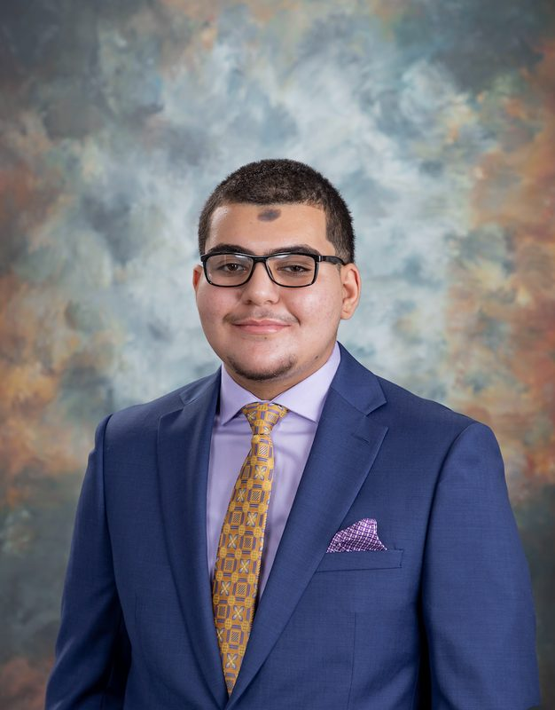
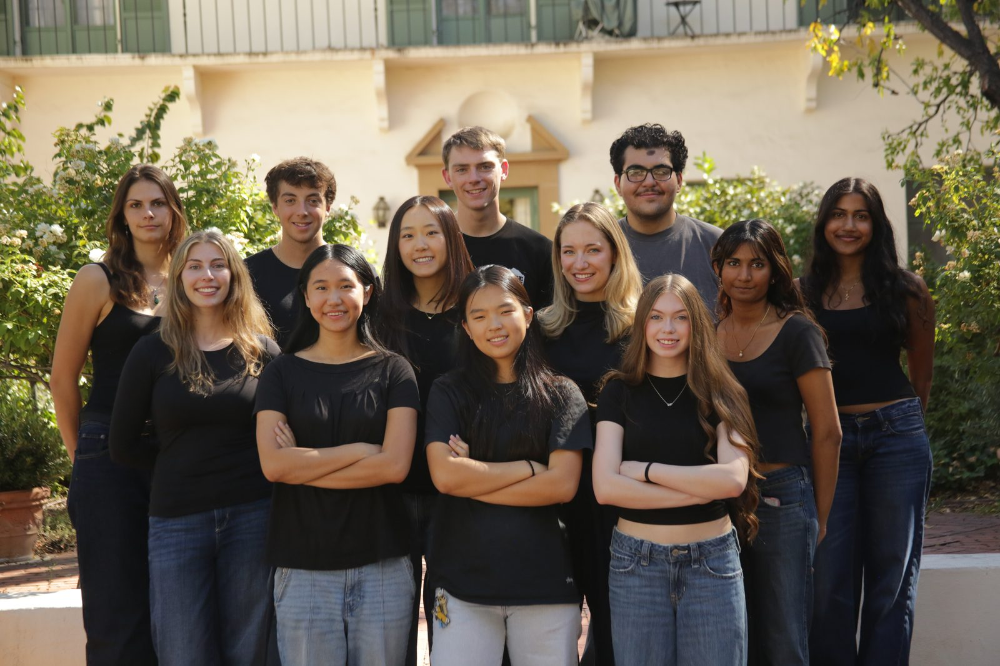
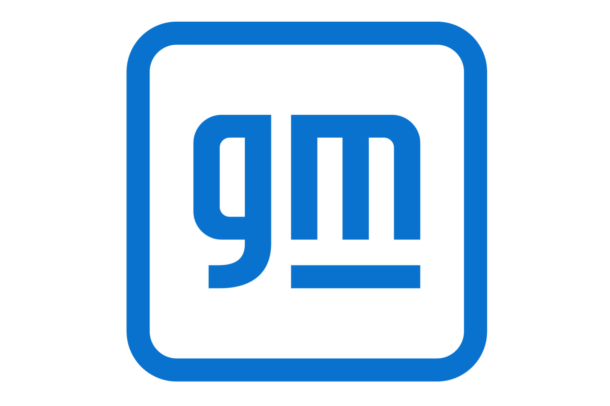
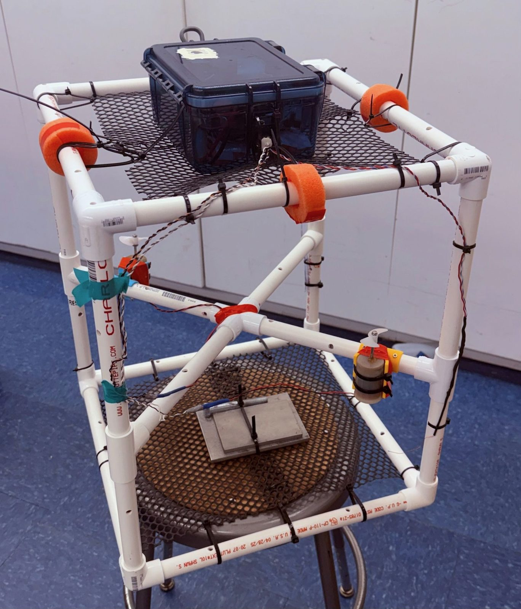
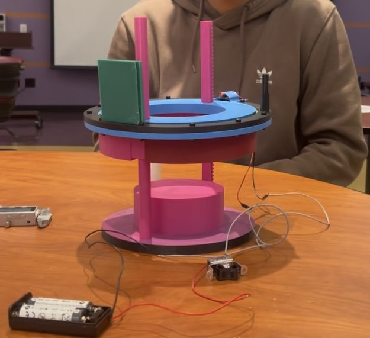

```{=html}
<div style="text-align: center; max-width: 720px; margin: 0 auto 2.5rem;">
  <h1 style="text-align: center; width: 100%; margin: 0 0 1rem;">Ali El Seblani</h1>
  
  <p style="color: #555; font-weight: 600; margin: 0 0 1rem;">Mechanical Engineering · Harvey Mudd College · Expected May 2028</p>
  <p style="text-align: left; line-height: 1.6;">Welcome to my engineering portfolio! I'm a junior engineering major at Harvey Mudd College focused on dynamics, robotics, and mechatronics. This past summer I interned at General Motors' Autonomous Robotics Center, and I'm now the Powertrain Lead for Harvey Mudd Racing's first Formula SAE car. I'm also a Machine Shop Proctor and a Systems Engineering Practicum Proctor. I'm seeking Summer 2027 internships.</p>
  <div style="margin-top: 1rem;">
    <a href="resume.html" style="display: inline-block; margin: 0.25rem; padding: 0.45rem 1rem; border: 1px solid #2c3e50; border-radius: 6px; text-decoration: none; font-weight: 600; background: #2c3e50; color: #fff;">Resume</a>
    <a href="mailto:aelseblani@g.hmc.edu" style="display: inline-block; margin: 0.25rem; padding: 0.45rem 1rem; border: 1px solid #2c3e50; border-radius: 6px; text-decoration: none; font-weight: 600;">Email</a>
    <a href="https://www.linkedin.com/in/ali-el-seblani-596499322/" target="_blank" style="display: inline-block; margin: 0.25rem; padding: 0.45rem 1rem; border: 1px solid #2c3e50; border-radius: 6px; text-decoration: none; font-weight: 600;">LinkedIn</a>
  </div>
</div>

<h2 style="text-align: center;">Featured work</h2>

<div class="feature-grid">

  <a class="feature-card" href="racing.html">
    
    <div class="feature-body">
      <h3>Harvey Mudd Racing</h3>
      <p class="feature-impact">Leading a 7+ person powertrain team · first competition May 2027</p>
    </div>
  </a>

  <a class="feature-card" href="project-pages/GeneralMotors.html">
    
    <div class="feature-body">
      <h3>General Motors Internship</h3>
      <p class="feature-impact">63% fewer material touches · ~$1M/yr projected savings</p>
    </div>
  </a>

  <a class="feature-card" href="project-pages/auv.html">
    
    <div class="feature-body">
      <h3>Autonomous Ocean Profiling Robot</h3>
      <p class="feature-impact">Held depth waypoints autonomously down to 3 m</p>
    </div>
  </a>

  <a class="feature-card" href="project-pages/laser.html">
    
    <div class="feature-body">
      <h3>Flexible Measuring Laser</h3>
      <p class="feature-impact">Under 1 mm accuracy · no contact with the sample</p>
    </div>
  </a>

</div>
```