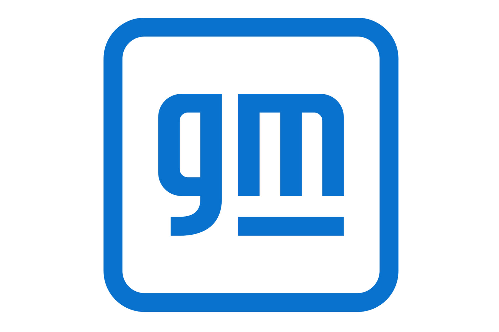
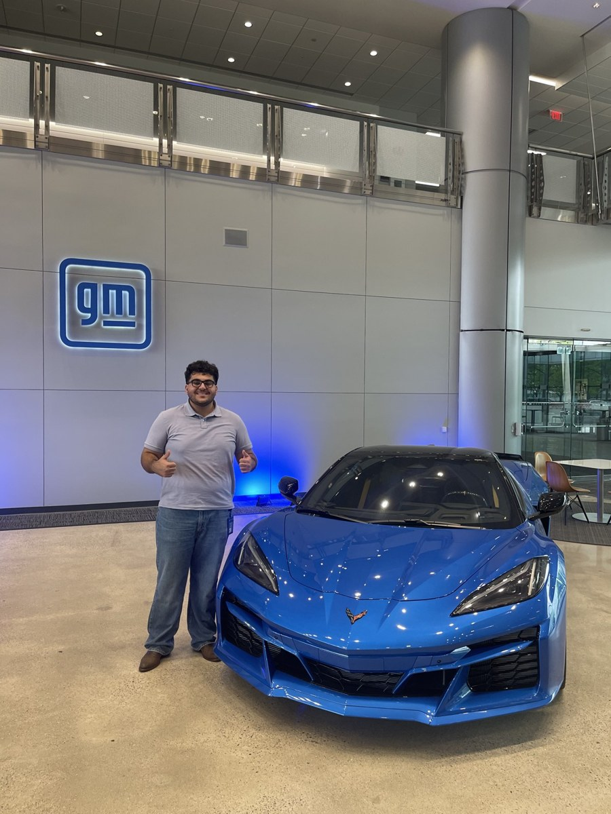
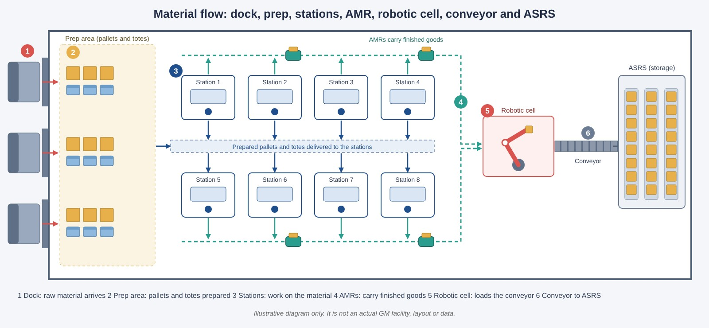

```{=html}
<div style="border: 1px solid #ddd; border-radius: 6px; padding: 15px 20px; margin-bottom: 30px; background: white;">
  <span style="font-weight: 700; letter-spacing: 2px; font-size: 0.95rem;">GENERAL MOTORS</span> — <em style="color: #666;"> Autonomous Robotics Center Manufacturing Engineering Intern</em>
</div>
```

```{=html}
<style>
.gm-top { display:flex; gap:2.2rem; align-items:flex-start; flex-wrap:wrap; margin-bottom:1.5rem; }
.gm-text { flex:1 1 380px; min-width:0; }
.gm-text p { margin:0 0 1rem; }
.gm-logo { float:left; width:150px; height:auto; margin:0 1.5rem 0.5rem 0; mix-blend-mode:multiply; }
.gm-photo { flex:0 1 290px; width:290px; max-width:100%; height:auto; border-radius:10px; }
.gm-note { color:#d9322d; font-weight:700; font-size:1.02rem; line-height:1.4; margin:1.5rem 0 0.8rem; }
.gm-flow { width:100%; height:auto; border-radius:8px; border:1px solid #dde3ea; display:block; }
</style>

<div class="gm-top">
  <div class="gm-text">
    
    <p>This past summer, I interned at General Motors in the General Assembly department and the Autonomous Robotics Center division in Burton, Michigan as a Manufacturing Engineering Intern. I was directly on the floor of a live processing plant, supporting the launch and integration of an Automated Storage and Retrieval System (ASRS) — a large-scale automation initiative aimed at transforming how materials are stored, retrieved, and delivered across production departments.</p>
    <p>My role placed me at the intersection of engineering and operations, where I worked alongside cross-functional teams to redesign material-handling workflows, analyze production data, and develop workstation concepts that would support the seamless transition to a more automated environment.</p>
    <p>I also had the privilege of developing and earning a Green Belt in Design for Six Sigma (DFSS) — a certification that has fundamentally shaped how I approach engineering problems. DFSS trained me to minimize variation and bias in process design, allowing me to build fine-tuned solutions that are statistically validated.</p>
  </div>
  
</div>

<p class="gm-note">Note: Plant-floor imagery and detailed project data have been omitted due to proprietary manufacturing and confidentiality standards.</p>



<p class="gm-note">Note: The diagram above is a computer-generated visualization of the kind of material flow I worked on. It is not a photo or drawing of any GM facility, and in no way represents any property, layout or data of GM.</p>
```

## Links

[Back to Work Experience](../work_experience.qmd)
