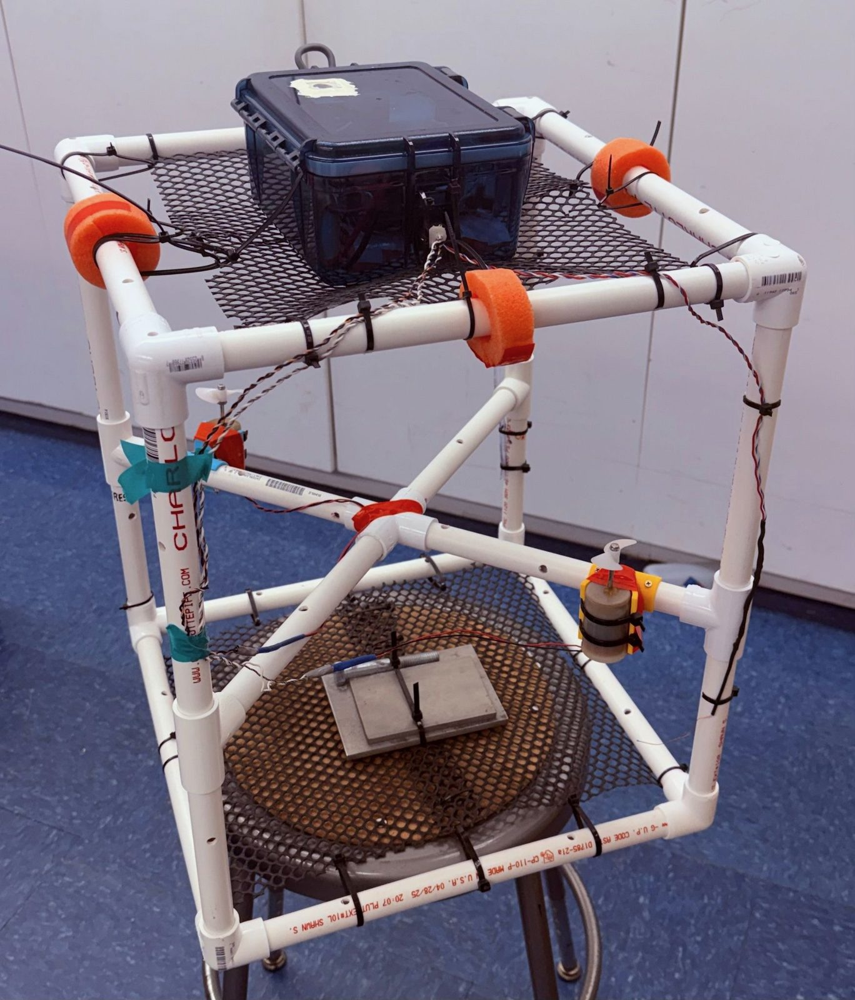
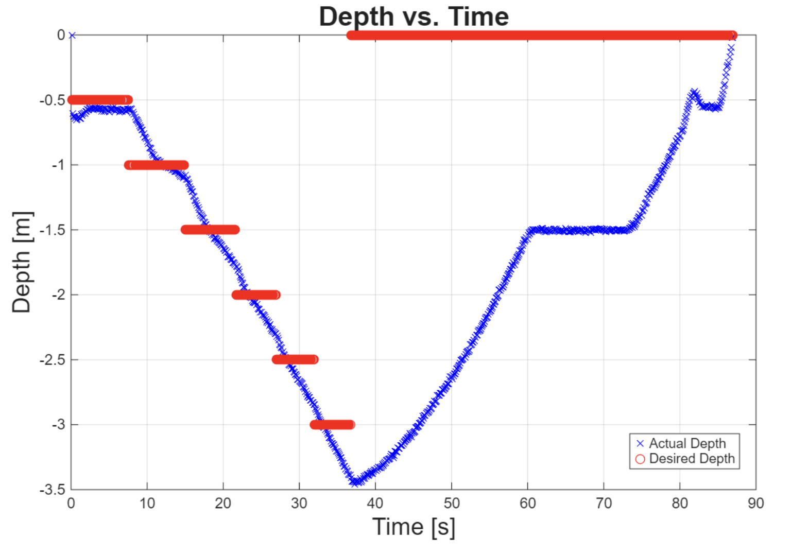
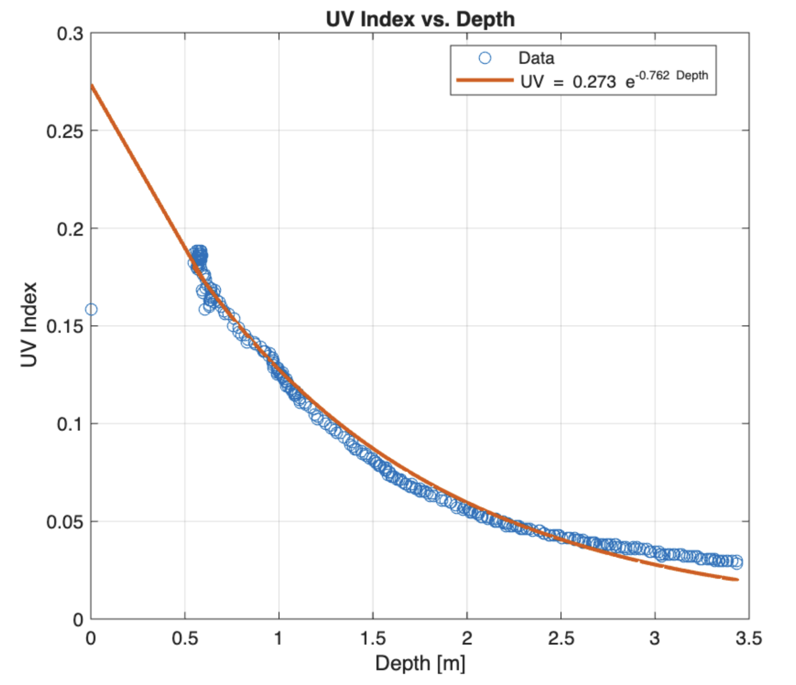
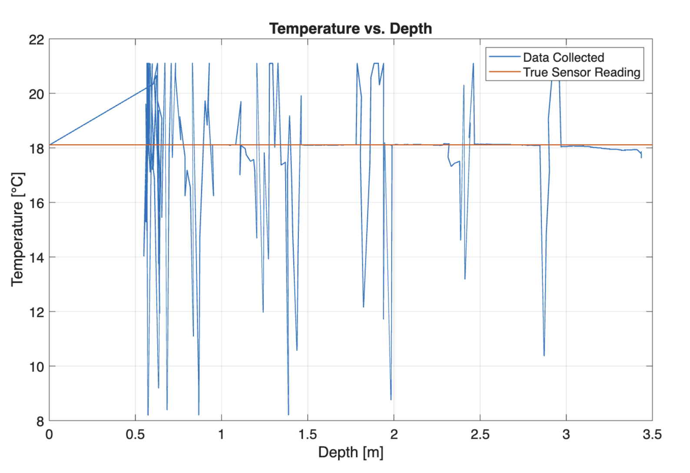
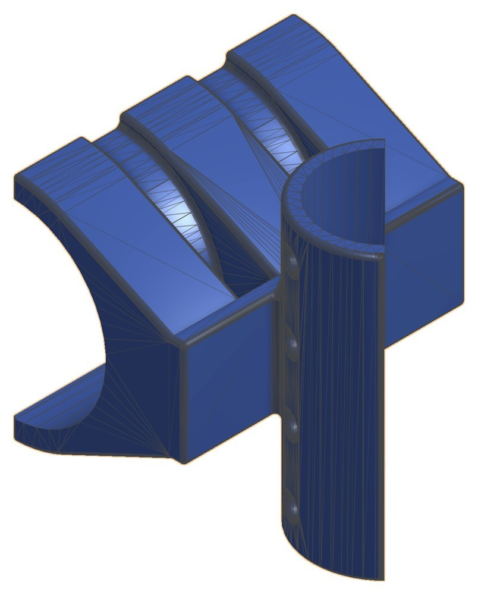
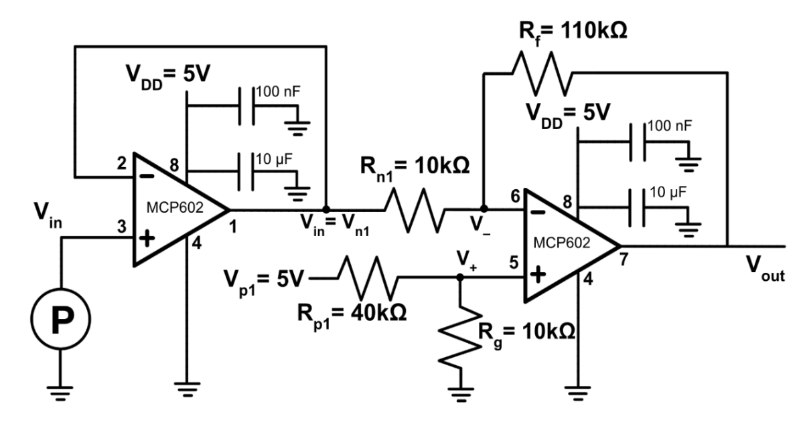
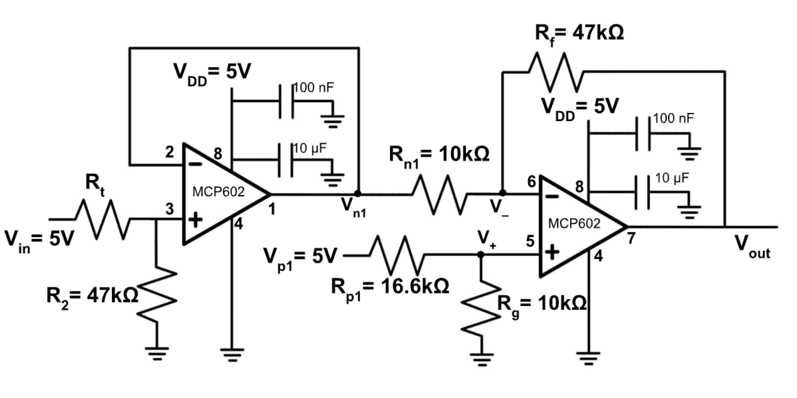
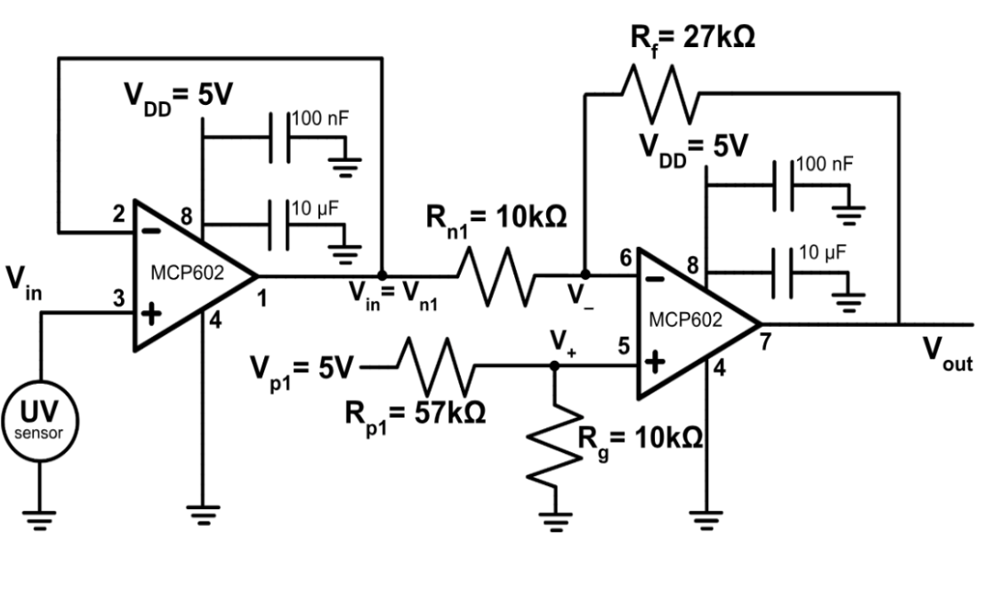
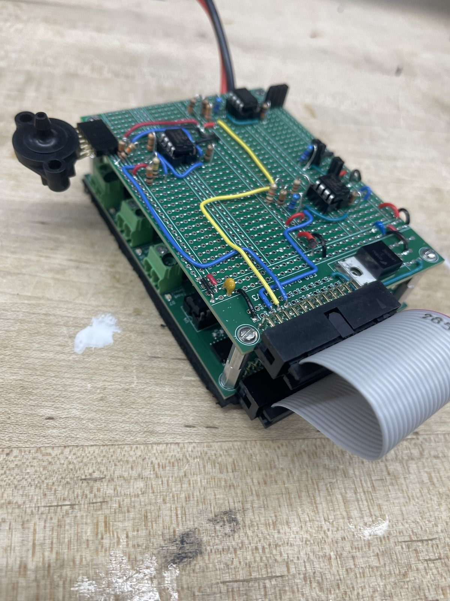
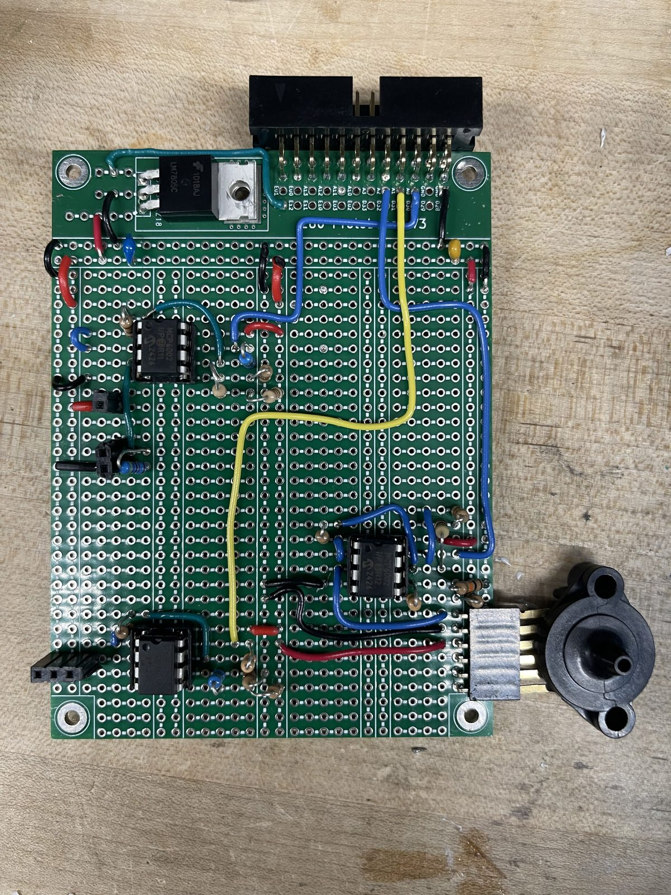

<style>
.auv-hero { display:grid; grid-template-columns:minmax(300px,1fr) 1fr; gap:2.5rem; align-items:start; margin-bottom:1.5rem; }
.auv-hero img { width:100%; height:auto; display:block; border-radius:8px; }
.auv-cap { font-size:0.85rem; color:#666; text-align:center; margin-top:0.4rem; }
.auv-facts { background:#f5f7fa; border-left:4px solid #1f4e8c; border-radius:6px; padding:0.8rem 1rem; font-size:0.95rem; }
.auv-facts p { margin:0.2rem 0; }
.auv-stats { display:grid; grid-template-columns:repeat(auto-fit,minmax(170px,1fr)); gap:1rem; margin:1rem 0 1.5rem; }
.auv-stat { border:1px solid #dde3ea; border-radius:8px; padding:0.8rem; text-align:center; }
.auv-stat b { display:block; font-size:1.5rem; color:#1f4e8c; }
.auv-stat span { font-size:0.85rem; color:#555; }
.auv-row { display:grid; grid-template-columns:repeat(auto-fit,minmax(240px,1fr)); gap:1.2rem; margin:1rem 0 1.5rem; align-items:start; }
.auv-row figure { margin:0; text-align:center; }
.auv-row img { width:100%; height:auto; border-radius:6px; }
.auv-row figcaption { font-size:0.85rem; color:#666; margin-top:0.4rem; }
@media (max-width:800px){ .auv-hero{ grid-template-columns:1fr; gap:1.2rem; } }
details.hc { border:1px solid #dde3ea; border-radius:8px; padding:0.3rem 1rem; margin:0.7rem 0; background:#fff; }
details.hc summary { font-weight:600; cursor:pointer; padding:0.5rem 0; }
</style>

```{=html}
<div class="auv-hero">
  <figure style="margin:0">
    
    <div class="auv-cap">The final robot build.</div>
  </figure>
  <div>
    <p><b>Summary.</b> In Experimental Engineering (E80) at Harvey Mudd, our team of four designed, built and deployed an autonomous underwater vehicle that dove to 3 m at Dana Point, California, and measured how <b>UV intensity and temperature change with depth</b>. Both depend on sunlight and matter to marine life: some fish use UV for vision, while UV-B can seriously harm plankton.</p>
    <div class="auv-facts">
      <p><b>Course:</b> E80 Experimental Engineering, Spring 2026</p>
      <p><b>Team:</b> Ali El Seblani, Carolyn Davis, Keegan Cabrera, Jessica Li</p>
      <p><b>Sensors:</b> MPX5700 pressure, Murata NXFT15WB473FA2B150 thermistor, GUVA-S12SD UV</p>
      <p><b>Constraint:</b> $50 budget for sensors</p>
      <p><b>Controller:</b> Teensy 4.0, 10 Hz logging to SD card</p>
    </div>
  </div>
</div>
```

## What I was responsible for

- **Electrical design.** I led the design of the resistance-to-voltage interface for the thermistor and assisted with the voltage-to-voltage interface for the pressure sensor. The team's sensor interfaces each use a unity-gain buffer and an inverting offset amplifier.
- **Calibration.** I developed the calibration procedures and curves for the pressure and temperature sensors, and the field check of the UV sensor.
- **Depth control.** I developed the C++ depth-control algorithm that sent the robot to each waypoint.
- **Data analysis.** I wrote the MATLAB scripts that read the SD-card logs and produced the depth, temperature and UV plots.
- **Buoyancy.** I helped design and build the frame and ballast so the robot stayed neutrally buoyant in saltwater with minimal tilt.

## Results

```{=html}
<div class="auv-stats">
  <div class="auv-stat"><b>0.5 to 3 m</b><span>depth waypoints reached autonomously</span></div>
  <div class="auv-stat"><b>~46% / m</b><span>UV decay with depth, UV = 0.273·e<sup>−0.762·depth</sup></span></div>
  <div class="auv-stat"><b>0.189 → 0.03</b><span>UV reading from 0 to 3 m (84% drop)</span></div>
  <div class="auv-stat"><b>18.1 °C</b><span>steady temperature, 0.6 °C below the 18.7 °C ground-truth reading</span></div>
</div>
```

UV intensity fell off exponentially with depth, as Beer-Lambert attenuation predicts, so almost no UV reached 3 m. Temperature stayed essentially constant over the 0 to 3 m range tested. The deployment was on an overcast morning at about 8:30 am, with a surface UV rating near 2.

The robot also had clear limits. At greater depth it lost neutral buoyancy and began to sink, so after its last waypoint it could not resurface by itself. The thermistor was close to the motors, so electromagnetic interference made the temperature trace very noisy. I read temperature only during the 4-second motor stops at each waypoint, when the motors were off.

```{=html}
<div class="auv-row">
  <figure><figcaption>Depth vs. desired depth over time. The robot reaches each waypoint.</figcaption></figure>
  <figure><figcaption>UV intensity vs. depth, decaying exponentially.</figcaption></figure>
  <figure><figcaption>Temperature vs. depth. Gaps between motor spikes give the true readings.</figcaption></figure>
</div>
```

## Design decisions

- **Why UV and temperature.** We compared four concepts: a surface vehicle with a UV and temperature heat map, a salinity profiler, a current-and-depth profiler, and a surface vehicle with a tethered AUV. We chose the depth profile of UV and temperature because both come from the sun and it needed only three added sensors, which fit the $50 sensor limit.
- **Sensor ranges.** Each sensor was scaled to 0.3 to 3 V so the Teensy's 0 to 3.3 V input never clipped, and so each signal used the full range for better resolution. Pressure used a gain of about 10 with inverted output, mapping 0 m to high voltage and 3 m to low.
- **Calibration.** I calibrated depth against voltage with a meter stick in 0.1 m steps, then repeated it at Dana Point because saltwater (about 1020 kg/m³) differs from fresh water. A best-fit line through the 0 to 1 m data gave depth = −1.9 × voltage + 5.17 (depth in meters, voltage in volts). I calibrated the thermistor against a thermometer across 10 to 20 °C.
- **Stability.** A symmetric, rigid frame limited tilt. The electronics box sits high so the center of buoyancy is above the center of mass, and I sized ballast from the buoyancy calculation. Motors sit at least 30 cm from the electronics to cut interference.
- **Motor mounts.** We designed in CAD and 3D printed mounts that hold the two motors steady and an equal distance apart. Where the motors sit mattered as much as how they are held. A motor underneath the electronics box would push water up against it, which adds buoyancy and keeps the robot from diving. Motors near the sensors also induce electromagnetic noise in their signals. So the mounts keep the motors at least 30 cm from the electronics and out of line with the box. We 3D printed the mounts in PLA because printing made them easy to manufacture and let us prototype quickly without adding to our cost.
- **UV window.** A quartz window over the UV sensor keeps the electronics box from absorbing UV.

```{=html}
<figure style="margin:1rem auto;max-width:360px;text-align:center">
  
  <figcaption class="auv-cap">The motor mount we modeled in CAD and 3D printed.</figcaption>
</figure>
```

```{=html}
<div class="auv-row">
  <figure><figcaption>Pressure: voltage-to-voltage interface with unity-gain buffer.</figcaption></figure>
  <figure><figcaption>Thermistor: resistance-to-voltage inverting offset amplifier.</figcaption></figure>
  <figure><figcaption>UV: sensor output buffered and offset to the Teensy range.</figcaption></figure>
</div>
<div class="auv-row" style="max-width:700px;margin-left:auto;margin-right:auto">
  <figure><figcaption>Isometric PCB view.</figcaption></figure>
  <figure><figcaption>Top-down PCB view.</figcaption></figure>
</div>
```

## Hand calculations

I sized the robot and its circuits by hand before building anything. Each calculation opens to show the steps.

<details class="hc" open>
<summary>Stability: keeping the center of buoyancy above the center of mass</summary>

**Goal.** The robot must not tip over underwater, so its center of buoyancy (COB) has to sit above its center of mass (COM). Two design choices make that happen. The electronics box is mostly empty, so the air in it adds a large amount of buoyancy high on the frame, and foam floats on the top PVC raise the COB further. Ballast at the bottom pulls the COM down.

**1. Buoyancy of the air-filled electronics box.** The box measures 0.15 × 0.13 × 0.08 m, so $V = 1.56\times10^{-3}\ \text{m}^3$.

$$F_{box} = \rho g V = (997)(9.81)(1.56\times10^{-3}) = 15.26\ \text{N (fresh water)}$$

With saltwater ($\rho = 1025$ kg/m³) this becomes 15.69 N.

**2. Total buoyancy.** Add 10 N from the floats on the Lab 1 robot and 5 N for the extra PVC we added, which assumes 1.5 times the PVC of the Lab 1 robot.

$$F_B = 15.26 + 10 + 5 = 30.26\ \text{N (fresh)}\qquad F_B = 15.69 + 10 + 5 = 30.69\ \text{N (salt)}$$

**3. Ballast for neutral buoyancy.** The robot is neutral when its weight equals $F_B$. The robot without ballast is about 1 kg, so

$$m_{ballast} = \frac{F_B}{g} - m_{robot} = \frac{30.26}{9.81} - 1 = 2.08\ \text{kg (fresh)}\qquad \frac{30.69}{9.81} - 1 = 2.13\ \text{kg (salt)}$$

**4. Center of mass.** I split the robot into three levels and estimated each one's mass and its height above the bottom.

| Level | Height (cm) | Mass (kg) |
|---|---|---|
| Bottom (ballast) | 0 | 2.5 |
| Middle | 25 | 0.3 |
| Top | 55 | 0.2 |

$$COM = \frac{\sum x\,m}{\sum m} = \frac{0(2.5) + 25(0.3) + 55(0.2)}{3.0} = 6.17\ \text{cm}$$

**5. Center of buoyancy.** I did the same with the buoyancy of each level, with the air-filled box as its own term.

| Level | Height (cm) | Buoyancy (N) |
|---|---|---|
| Bottom | 0 | 3 |
| Electronics box | 4 | 15.26 |
| Middle | 25 | 5 |
| Top (floats) | 55 | 7 |

$$COB = \frac{\sum x\,F}{\sum F} = \frac{0(3) + 4(15.26) + 25(5) + 55(7)}{30.26} = 18.87\ \text{cm}$$

**Result.** The COB is about 12.7 cm above the COM, so any tilt produces a torque that rights the robot. Because the box is empty, I also made sure the buoyancy it adds does not lift the robot out of balance, which is why the ballast sits at the very bottom.

</details>

<details class="hc">
<summary>Thermistor: resistance-to-voltage circuit (gain 4.7, Rf = 47 kΩ, Rn1 = 10 kΩ)</summary>

**Goal.** The circuit is an inverting offset amplifier built around the thermistor. It has to take the water temperatures we expected at Dana Point, 10 to 20 °C, and map them onto the Teensy's usable range of 0.3 to 3 V. Here $R_t$ is the thermistor's resistance.

{width=70%}

**1. Thermistor resistance at each end of the range.** With $R_0 = 47\ \text{k}\Omega$ at 25 °C and $\beta = 4050$:

$$R = R_0\, e^{\beta\left(\frac{1}{T}-\frac{1}{298.15}\right)}$$

$$R_{10^\circ C} = 47\text{k}\cdot e^{4050\left(\frac{1}{283.15}-\frac{1}{298.15}\right)} = 96{,}520\ \Omega$$

$$R_{20^\circ C} = 47\text{k}\cdot e^{4050\left(\frac{1}{293.15}-\frac{1}{298.15}\right)} = 59{,}254\ \Omega$$

**2. Expected voltage.** I put the thermistor in a voltage divider with $R_2 = 47\ \text{k}\Omega$ (its resistance at room temperature) and $V_{in} = 5$ V. The output sits between $R_t$ and $R_2$:

$$V_{out} = V_{in}\,\frac{R_2}{R_t + R_2}$$

$$V_{out,10} = 5\cdot\frac{47000}{96520+47000} = 1.637\ \text{V}\qquad V_{out,20} = 5\cdot\frac{47000}{59254+47000} = 2.21\ \text{V}$$

**3. Gain.** The Teensy's range is 0.3 to 3 V, so the 0.573 V swing has to grow to 2.7 V:

$$gain = \frac{\Delta V_{out}}{\Delta V_{in}} = \frac{3-0.3}{2.21-1.637} = 4.71$$

The amplifier is inverting, so

$$gain = -\frac{R_f}{R_{n1}} = -4.71\ \Rightarrow\ R_f = 4.71\,R_{n1}$$

I used $R_f = 47\ \text{k}\Omega$ and $R_{n1} = 10\ \text{k}\Omega$, which gives 4.7.

**4. Offset.** The inverting gain flips high and low, so the highest input (20 °C, 2.21 V) becomes the lowest output:

$$2.21\times(-4.71) = -10.41\ \text{V}$$

I want that point to read 0.3 V, so the offset is $0.3 + 10.41 = 10.71$ V.

**5. Offset resistors.** The amplifier's output is

$$V_{out} = \left(1+\frac{R_f}{R_{n1}}\right)\left(\frac{R_g}{R_{p1}+R_g}\right)V_{p1} - \frac{R_f}{R_{n1}}\,V_{in}$$

The first term is the offset, so I solve it for 10.71 V. Let $V_+ = V_{p1}\frac{R_g}{R_g+R_{p1}}$ be the voltage at the non-inverting input:

$$\left(1+\frac{R_f}{R_{n1}}\right)V_+ = 10.71\ \Rightarrow\ V_+ = \frac{10.71}{5.71} = 1.876\ \text{V}$$

With $V_{p1} = 5$ V:

$$1.876 = 5\,\frac{R_g}{R_g+R_{p1}}\ \Rightarrow\ R_{p1} = 1.66\,R_g$$

**Final values:** $R_g = 10\ \text{k}\Omega$, $R_{p1} = 16.6\ \text{k}\Omega$, $R_f = 47\ \text{k}\Omega$, $R_{n1} = 10\ \text{k}\Omega$.

</details>

<details class="hc">
<summary>Pressure sensor: voltage-to-voltage circuit (gain 11, Rf = 110 kΩ, Rn1 = 10 kΩ)</summary>

**Goal.** Turn the pressure sensor's small voltage change over 0 to 3 m of depth into a signal that fills most of the Teensy's range. A unity-gain buffer sits in front of the amplifier so the sensor is not loaded.

{width=70%}

**1. Sensor output.** From the datasheet, with $V_S = 5$ V, $P_{atm} = 101.3$ kPa (from a barometer) and $\rho = 1020$ kg/m³ for seawater:

$$V_{in} = V_S\left(0.0012858\,(P_{atm}+\rho g h) + 0.04\right)$$

At 0 m this is 0.851 V and at 3 m it is 1.044 V, so $\Delta V_{in} = 0.193$ V.

**2. Gain.** I want the output to swing 2.0 V (0.5 V to 2.5 V) over that range:

$$|gain| = \frac{\Delta V_{out}}{\Delta V_{in}} = \frac{2.0}{0.193} = 10.36 = \frac{R_f}{R_{n1}}\ \Rightarrow\ R_f = 103.6\ \text{k}\Omega\ \text{for}\ R_{n1} = 10\ \text{k}\Omega$$

The gain is negative, so 0 m reads high and 3 m reads low. Keeping it near 10 limits the error that gain adds.

**3. Offset.** I place the 0 m reading at 2.2 V, so the 3 m reading lands near 0.2 V:

$$V_{offset} = V_{in}(0)\cdot gain + 2.2 = 0.851(10.36) + 2.2 = 11.02\ \text{V}$$

The offset comes from $(1+G)\,V_+$, so

$$V_+ = \frac{11.02}{1+10.36} = 0.970\ \text{V}$$

**4. Offset resistors.** With $V_{p1} = 5$ V and $R_g = 10\ \text{k}\Omega$:

$$V_+ = 5\,\frac{R_g}{R_g+R_{p1}}\ \Rightarrow\ R_{p1} = 41.5\ \text{k}\Omega$$

**5. Built values.** The calculation gives $R_f = 103.6\ \text{k}\Omega$. I built the circuit with $R_f = 110\ \text{k}\Omega$, which is close to the ideal and gives a slightly higher gain of 11, along with $R_{n1} = 10\ \text{k}\Omega$, $R_{p1} = 40\ \text{k}\Omega$ and $R_g = 10\ \text{k}\Omega$. The output is then $V_{out} = 12 - 11\,V_{in}$, which is about 2.64 V at 0 m and 0.51 V at 3 m, still well inside the Teensy's 0.3 to 3 V range.

</details>

<details class="hc">
<summary>UV sensor: voltage-to-voltage circuit (gain 2.7, Rf = 27 kΩ, Rn1 = 10 kΩ)</summary>

**Goal.** The sensor outputs $V = 0.1\times UV$. Dana Point's UV index could reach about 8, so the sensor output spans 0 to 0.8 V. A unity-gain buffer sits in front of the amplifier, and the circuit places the signal on the Teensy's range.

{width=70%}

**1. Gain.** I want the output to run from 2.8 V at UV 0 down to 0.6 V at UV 8:

$$|gain| = \frac{\Delta V_{out}}{\Delta V_{in}} = \frac{2.8-0.6}{0.8-0} = 2.75 = \frac{R_f}{R_{n1}}\ \Rightarrow\ R_f = 27.5\ \text{k}\Omega\ \text{for}\ R_{n1} = 10\ \text{k}\Omega$$

**2. Offset.** At UV 0 the sensor voltage is 0, so the output there is the offset itself, 2.8 V:

$$(1+G)\,V_+ = 2.8\ \Rightarrow\ V_+ = \frac{2.8}{1+2.75} = 0.747\ \text{V}$$

**3. Offset resistors.** With $V_{p1} = 5$ V and $R_g = 10\ \text{k}\Omega$:

$$V_+ = 5\,\frac{R_g}{R_g+R_{p1}}\ \Rightarrow\ R_{p1} = 57.0\ \text{k}\Omega$$

**4. Built values.** I used $R_f = 27\ \text{k}\Omega$ (gain 2.7), $R_{n1} = 10\ \text{k}\Omega$, $R_{p1} = 57\ \text{k}\Omega$ (a 47 kΩ and a 10 kΩ resistor in series) and $R_g = 10\ \text{k}\Omega$. Those give an actual offset of 2.76 V and $V_{out} = 2.76 - 2.7\,V_{in}$.

**Breadboard check.**

| UV index | Predicted output | Measured output | Error |
|---|---|---|---|
| 0 | 2.76 V | 2.75 V | 0.4% |
| 8 | 0.60 V | 0.66 V | 8.9% |

</details>

<details class="hc">
<summary>Battery life</summary>

The motors draw the most current, and in Lab 0 each motor pulled less than 500 mA. With two motors and a 3300 mAh battery:

$$t = \frac{3300\ \text{mAh}}{2\times 500\ \text{mA}} = 3.3\ \text{hours}$$

</details>

## Problems and how we handled them

- **Motor noise in the temperature signal.** Salt water is conductive, so the motors' electromagnetic interference swamped the thermistor. We programmed a 4-second motor stop at each waypoint and read temperature only during those gaps.
- **Buoyancy changed with depth.** The robot was neutral at the surface but became heavier as pressure rose, so it sank at the last waypoint and could not resurface alone.
- **Saltwater ballast.** The extra density of seawater changed how much ballast we needed, so we trimmed it on site before the dive.

## Deployment

We deployed near the pier at Dana Point harbor. On site we checked waterproofing, trimmed ballast for saltwater and recorded ground-truth readings (18.7 °C, UV rating about 2, 101.3 kPa) before the dive. The robot logged to an SD card, which we analyzed in MATLAB afterward.

```{=html}
<figure style="margin:1rem auto;max-width:800px;text-align:center">
  
  <figcaption class="auv-cap">Aerial view of the Dana Point harbor. The red dot marks where we deployed, in the water near the pier.</figcaption>
</figure>
```

## What I would change

Move the thermistor well away from the motors to remove the noise, and redo the ballast for the pressure at depth so the robot stays neutral and can surface. We would also repeat the dive at other harbor locations and times of day to compare UV and temperature.

## Files

[View Technical Paper](../images/El_Seblani_Ali_E80_Final_Report.pdf) | [View Poster](../images/E80_Poster_Team42.pdf)

[Back to Projects](../projects.qmd)
