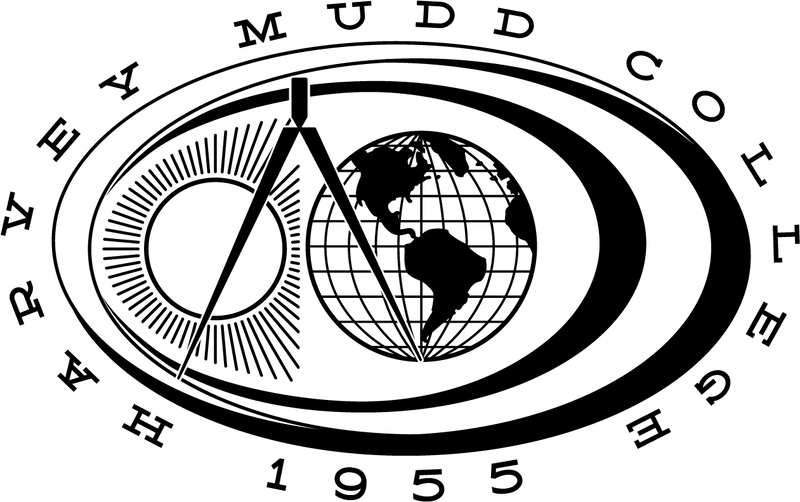

```{=html}
<div style="border: 1px solid #ddd; border-radius: 6px; padding: 15px 20px; margin-bottom: 30px; background: white;">
  <span style="font-weight: 700; letter-spacing: 2px; font-size: 0.95rem;">HARVEY MUDD COLLEGE</span> — <em style="color: #666;">Systems Engineering Practicum Proctor</em>
</div>



<p>E79 — Systems Engineering — is a rigorous lab-based course at Harvey Mudd College that uses underwater robotics as a teaching vehicle to introduce students to the systems engineering approach. Students learn to model, construct, analyze, design, and control mechanical, thermal, and electrical systems across 13 hands-on practicums spanning the full semester.</p>

<p>As a Systems Engineering Practicum Proctor, my role is to guide teams of two students through each 2.5-hour practicum session — helping them navigate complex concepts in underwater robotics, circuit design, soldering, and sensor integration. I ensure that students arrive prepared, work collaboratively, and follow strict safety protocols in the lab, including proper handling of electrical components, epoxies, and soldering equipment.</p>

<p>Beyond technical guidance, I serve as a resource for debugging, troubleshooting, and helping students connect theoretical systems engineering concepts to real hands-on challenges. Having built and deployed an underwater ROV myself in E79, I bring firsthand experience to every session — understanding exactly what students are working through and where they are likely to struggle.</p>

<div style="clear: both;"></div>
```

---

[E79 Practicum Site](https://sites.google.com/g.hmc.edu/e79-practicum/)

[Back to Work Experience](../work_experience.qmd)