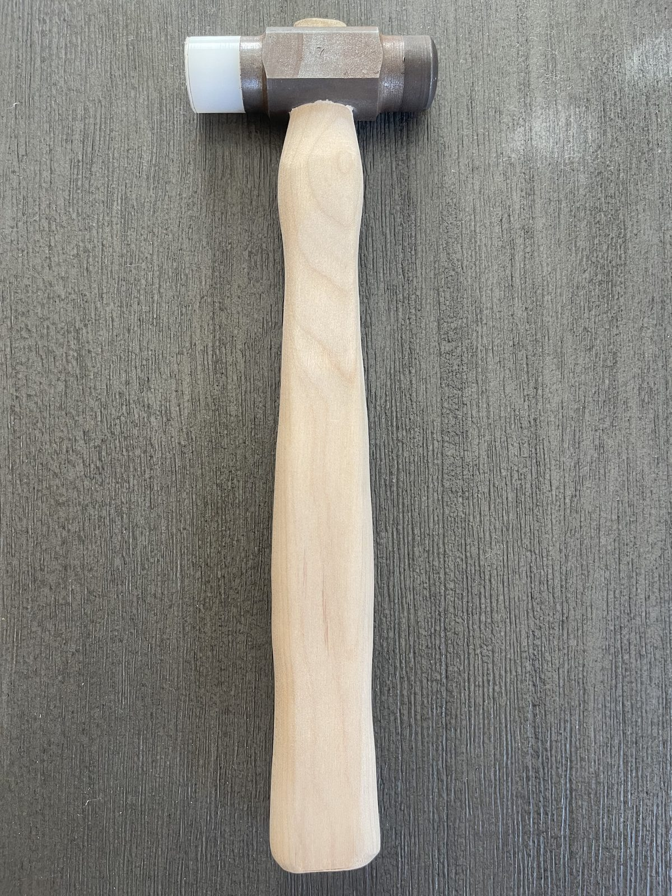

<style>
.pj-hero { display:grid; grid-template-columns:minmax(240px,0.8fr) 1fr; gap:2.5rem; align-items:start; margin-bottom:1.5rem; }
.pj-hero img { width:100%; height:auto; display:block; border-radius:8px; }
.pj-cap { font-size:0.85rem; color:#666; text-align:center; margin-top:0.4rem; }
.pj-facts { background:#f5f7fa; border-left:4px solid #1f4e8c; border-radius:6px; padding:0.8rem 1rem; font-size:0.95rem; }
.pj-facts p { margin:0.2rem 0; }
.pj-row { display:grid; grid-template-columns:repeat(auto-fit,minmax(240px,1fr)); gap:1.2rem; margin:1rem 0 1.5rem; align-items:start; }
.pj-row figure { margin:0; text-align:center; }
.pj-row img { width:100%; height:auto; border-radius:6px; }
.pj-row figcaption { font-size:0.85rem; color:#666; margin-top:0.4rem; }
@media (max-width:800px){ .pj-hero{ grid-template-columns:1fr; gap:1.2rem; } }
</style>

```{=html}
<div class="pj-hero">
  <figure style="margin:0">
    
    <div class="pj-cap">The finished machinist's hammer.</div>
  </figure>
  <div>
    <p><b>Summary.</b> In Engineering Design &amp; Manufacturing (E4), I machined a complete machinist's hammer from raw stock, working from engineering drawings to tolerances within thousandths of an inch. It continues the Harvey Mudd tradition of student-made hammers.</p>
    <div class="pj-facts">
      <p><b>Course:</b> E4 Engineering Design &amp; Manufacturing, Sep – Oct 2025</p>
      <p><b>Materials:</b> clear oak, AISI 1015 steel, AISI 4340 steel, nylon</p>
      <p><b>Machines:</b> lathe, mill, bandsaw, taps</p>
      <p><b>Measurement:</b> digital micrometers, HRC hardness tester</p>
    </div>
  </div>
</div>
```

## What I did

- **Followed the drawings.** I read the engineering drawings and process router and made each component from raw material.
- **Machined to tolerance.** I turned, faced, drilled, milled and tapped parts on the lathe and mill to within thousandths of an inch.
- **Heat treated the steel.** The steel parts were heat treated and tempered to reach the specified hardness, verified on an HRC hardness tester.
- **Checked as I went.** I measured with digital micrometers throughout and applied GD&T principles to keep dimensions in spec.

## Files

[View Technical Drawings](../images/Hammer-Technical_Drawings.pdf)

[Back to Projects](../projects.qmd)
