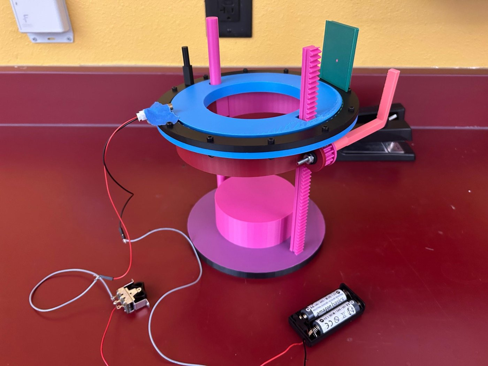
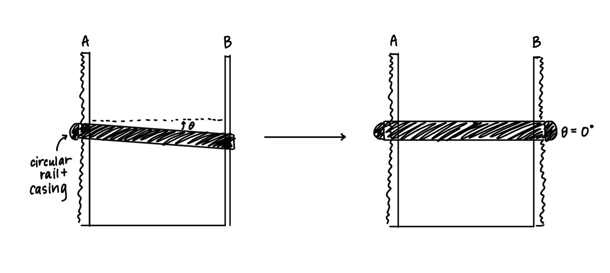
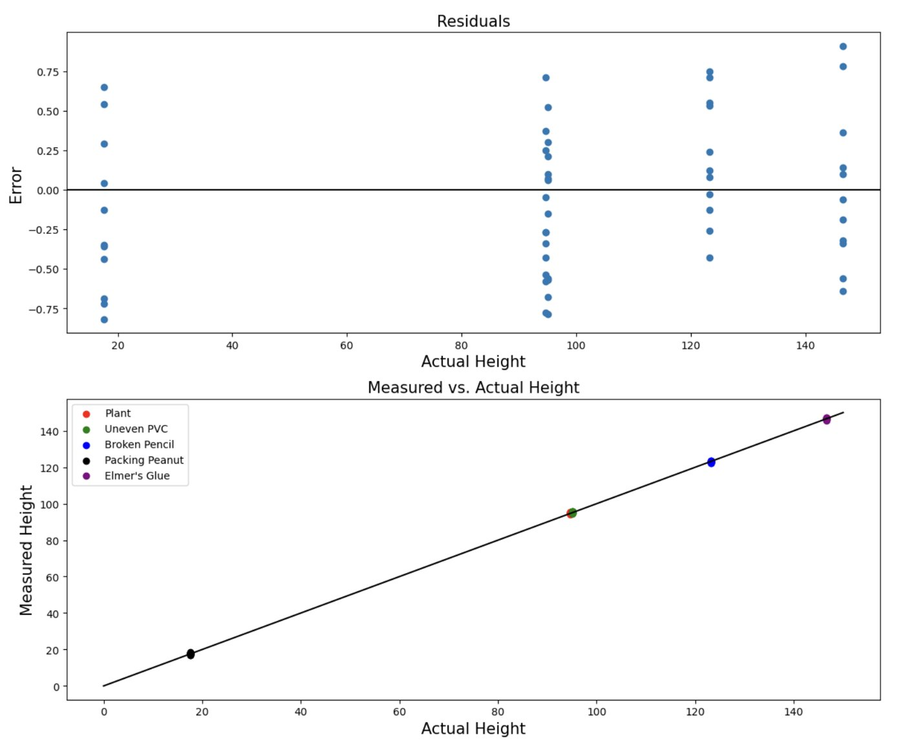
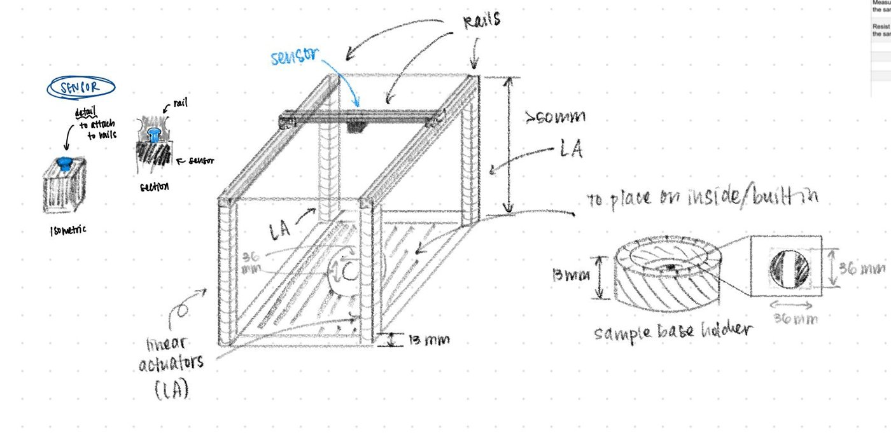

<style>
.lz-hero { display:grid; grid-template-columns:minmax(260px,0.8fr) 1fr; gap:2.5rem; align-items:start; margin-bottom:1.5rem; }
.lz-hero img { width:100%; height:auto; display:block; border-radius:8px; }
.lz-cap { font-size:0.85rem; color:#666; text-align:center; margin-top:0.4rem; }
.lz-facts { background:#f5f7fa; border-left:4px solid #1f4e8c; border-radius:6px; padding:0.8rem 1rem; font-size:0.95rem; }
.lz-facts p { margin:0.2rem 0; }
.lz-stats { display:grid; grid-template-columns:repeat(auto-fit,minmax(170px,1fr)); gap:1rem; margin:1rem 0 1.5rem; }
.lz-stat { border:1px solid #dde3ea; border-radius:8px; padding:0.8rem; text-align:center; }
.lz-stat b { display:block; font-size:1.5rem; color:#1f4e8c; }
.lz-stat span { font-size:0.85rem; color:#555; }
.lz-row { display:grid; grid-template-columns:repeat(auto-fit,minmax(280px,1fr)); gap:1.2rem; margin:1rem 0 1.5rem; align-items:start; }
.lz-row figure { margin:0; text-align:center; }
.lz-row img { width:100%; height:auto; border-radius:6px; }
.lz-row figcaption { font-size:0.85rem; color:#666; margin-top:0.4rem; }
@media (max-width:800px){ .lz-hero{ grid-template-columns:1fr; gap:1.2rem; } }
</style>

```{=html}
<div class="lz-hero">
  <figure style="margin:0">
    
    <div class="lz-cap">The final prototype (CALEL), printed in PLA.</div>
  </figure>
  <div>
    <p><b>Summary.</b> In Engineering Design &amp; Manufacturing (E4), our team designed a hand-operated gauge that lets Scanning Electron Microscope (SEM) users find the tallest point of a mounted sample <b>without touching it</b>. A rack and pinion raises a laser to the sample's height, and a slew bearing sweeps the beam around it to find the highest peak. The user then reads the height off digital calipers.</p>
    <div class="lz-facts">
      <p><b>Course:</b> E4 Engineering Design &amp; Manufacturing, Fall 2025</p>
      <p><b>Team:</b> Team BTE</p>
      <p><b>Client:</b> an SEM research lab, based in Australia</p>
      <p><b>Tools:</b> SolidWorks, 3D printing (PLA), digital calipers</p>
    </div>
  </div>
</div>
```

## The problem

SEM users had to estimate sample height by eye against a ruler, and then type that number into the microscope. A wrong height can crash a sample into the chamber and damage sensitive detectors, and the client said repairs can take months. The top of each sample also carries a conductive coating only nanometers thick, so anything that touches it can ruin it.

The client's requirements, in her priority order:

- Setup in under 30 seconds.
- No contact with the sample.
- Measurement increments of 1 mm or better.
- Fit a 10 cm sample holder with seven 26 mm samples.
- Measure up to a 50 mm height offset.

## What I was responsible for

- **Z-axis.** I designed the rack-and-pinion mechanism that raises and lowers the laser.
- **Radial sweep.** I designed the slew bearing that rotates the laser around the sample.
- **Laser system.** I worked on the laser and its protective wall, and on the CAD drawings, bill of materials and process router for the final design.

## How the design works

```{=html}
<div class="lz-row">
  <figure><figcaption>Side view of the known tilt: the bearing is supported by one rack (A) but not the other pillar (B).</figcaption></figure>
</div>
```

1. The user sets the sample on a 100 mm platform at the center of the base.
2. A hand crank turns the pinion along the rack and lifts the laser to the sample's height. A silicone O-ring adds friction so the crank stays put without backlash.
3. The user turns the slew bearing's handle to sweep the beam over the whole sample and find the tallest peak. The bearing's center hole is 3 mm wider than the platform, so it can never hit the sample.
4. A printed wall opposite the laser catches the beam, which protects eyes and makes the beam easy to see.
5. The user removes the sample and measures from the platform to the beam's center with the depth gauge of a digital caliper, reading the height off its display.

## Design decisions

- **Choosing a concept.** We generated five alternatives from a morphological chart: a flexible measuring laser, a circular aluminum gauge ring, a micrometer ruler, a LIDAR scanner and an inductive scanner. The LIDAR scanner failed the 30-second setup constraint. The inductive scanner scored highest overall but cost much more, and we asked for a budget increase to test it. The laser design, the lower-cost option, became our prototype.
- **Material.** We printed in PLA because it was free and easy to get. We recommended nylon to the client for its low friction and wear resistance, and she may have access to it.
- **Replicability.** The client asked for files, not a physical unit, so we delivered SolidWorks and STL packages that her team can print. The non-printed parts are cheap and easy to find, and cost about a third of our E4 budget.
- **Safety.** We sanded every sharp edge, including the cut threaded rod, and the material is non-toxic.

## Results

```{=html}
<div class="lz-stats">
  <div class="lz-stat"><b>0.39 mm</b><span>average error across test objects</span></div>
  <div class="lz-stat"><b>10–15 s</b><span>setup time, against a 30 s limit</span></div>
  <div class="lz-stat"><b>184 mm</b><span>maximum measurable height, against 50 mm needed</span></div>
  <div class="lz-stat"><b>0 contact</b><span>no part can touch the sample</span></div>
</div>
```

We had people outside our team follow a one-page instruction sheet to measure five objects of varying height: a PVC pipe, a glue bottle, a plant, a packing peanut and a broken pencil. We did not tell them the true heights. The average error was 0.39 mm, which scored 4 out of 5 on our accuracy rubric and met the client's 1 mm requirement.

```{=html}
<div class="lz-row">
  <figure><figcaption>Residuals (top) and measured vs. actual height (bottom) for the five test objects.</figcaption></figure>
</div>
```

The main flaw is a slight tilt. The bearing was attached to only one rack instead of also being supported by the second pillar, so it tilts a little as it rises. Our test users got the best readings by placing the caliper next to the tallest point, which keeps the tilt from skewing the number. We think the tilt explains most of the remaining error.

## What I would change

Add a second rack with a second pinion on a shared rod, so both sides lift equally and the tilt disappears. We also sketched an inductive-sensor design that would stop motorized motion automatically when it senses the conductive sample coating, which would remove human error entirely. We didn't build it because of time and budget.

```{=html}
<div class="lz-row" style="max-width:700px;margin-left:auto;margin-right:auto">
  <figure><figcaption>Sketch of the proposed inductive-sensor version.</figcaption></figure>
</div>
```

## Files

[View Technical Drawings, BOM & Process Router](../images/E4_Technical_Drawings_BOM_Process_Router.pdf)

[Back to Projects](../projects.qmd)
