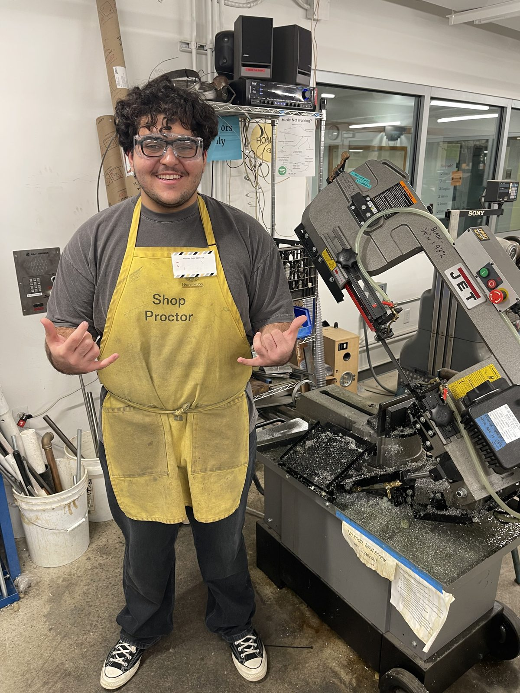
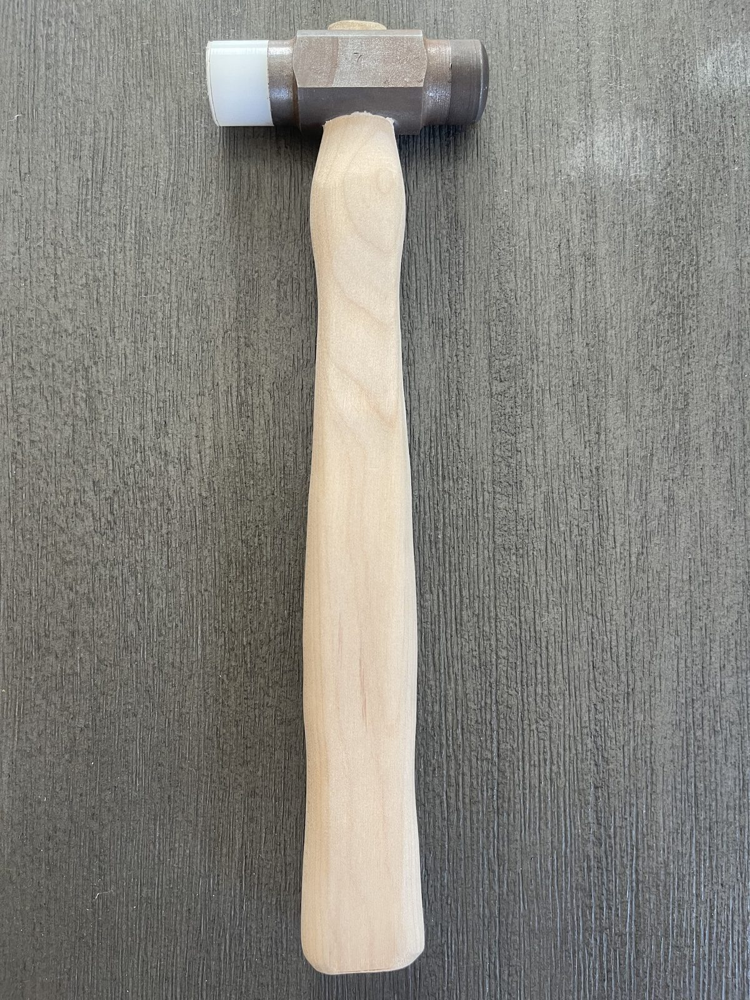

```{=html}
<div style="border: 1px solid #ddd; border-radius: 6px; padding: 15px 20px; margin-bottom: 30px; background: white;">
  <span style="font-weight: 700; letter-spacing: 2px; font-size: 0.95rem;">HARVEY MUDD COLLEGE</span> — <em style="color: #666;">Machine Shop Proctor</em>
</div>



<p>The Harvey Mudd Machine Shop serves as a creative space for the 7 Claremont Colleges, welcoming people from all different backgrounds in machining to work on personal projects, class projects, and team projects — allowing for the full spectrum of the creative space to come to life. The shop features both a wooden shop and a metal shop, each equipped with a variety of tools that support everything from early-stage prototyping to precision manufacturing.</p>

<p>As a Machine Shop Proctor, my role is to guide new and existing users on safe practices while assisting with project development for classes. This means being present on the floor, understanding what each person is trying to build, and helping them navigate the right tools, techniques, and processes to get there — safely and effectively.</p>

<p>Beyond day-to-day guidance, I participate in weekly trainings that continuously build my knowledge of machining, tooling, and manufacturing processes. These sessions have deepened my understanding of the machines I work with and made me a more effective resource for the students and makers who rely on the shop.</p>

<p>I also play a direct role in supporting engineering courses at Harvey Mudd, including Introduction to Engineering Design and Manufacturing and Mechanical Design, where I guide students through reading and following process routers and technical drawings to manufacture components to specification — skills that form the foundation of any engineering career.</p>

<div style="clear: both;"></div>
```

---

## Related project

```{=html}
<div class="feature-grid" style="grid-template-columns: minmax(0, 340px);">
  <a class="feature-card" href="hammer.html">
    
    <div class="feature-body">
      <p class="feature-kicker">E4 Engineering Design &amp; Manufacturing · Sep – Oct 2025</p>
      <h3>Machinist's Hammer</h3>
      <p class="feature-impact">Machined to within thousandths of an inch</p>
      <div class="chips"><span>Lathe</span><span>Mill</span><span>Heat treatment</span><span>GD&amp;T</span></div>
    </div>
  </a>
</div>
```

## Links

[HMC Machine Shop](https://sites.google.com/g.hmc.edu/hmc-machine-shop/home?authuser=0)

[Back to Work Experience](../work_experience.qmd)