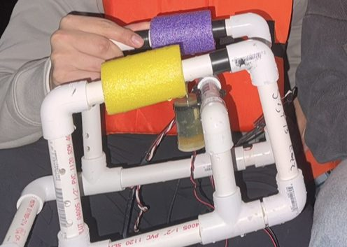
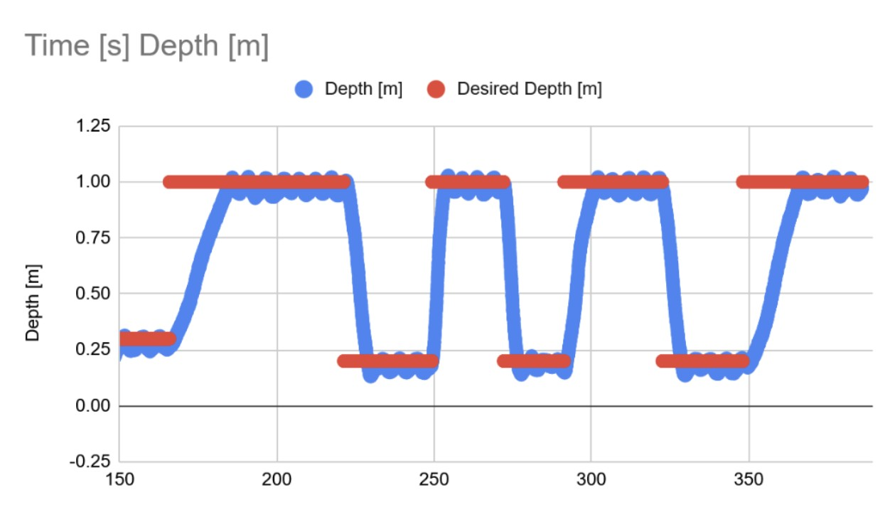

<style>
.pj-hero { display:grid; grid-template-columns:minmax(240px,0.8fr) 1fr; gap:2.5rem; align-items:start; margin-bottom:1.5rem; }
.pj-hero img { width:100%; height:auto; display:block; border-radius:8px; }
.pj-cap { font-size:0.85rem; color:#666; text-align:center; margin-top:0.4rem; }
.pj-facts { background:#f5f7fa; border-left:4px solid #1f4e8c; border-radius:6px; padding:0.8rem 1rem; font-size:0.95rem; }
.pj-facts p { margin:0.2rem 0; }
.pj-row { display:grid; grid-template-columns:repeat(auto-fit,minmax(240px,1fr)); gap:1.2rem; margin:1rem 0 1.5rem; align-items:start; }
.pj-row figure { margin:0; text-align:center; }
.pj-row img { width:100%; height:auto; border-radius:6px; }
.pj-row figcaption { font-size:0.85rem; color:#666; margin-top:0.4rem; }
@media (max-width:800px){ .pj-hero{ grid-template-columns:1fr; gap:1.2rem; } }
</style>

```{=html}
<div class="pj-hero">
  <figure style="margin:0">
    
    <div class="pj-cap">The finished submersible ROV.</div>
  </figure>
  <div>
    <p><b>Summary.</b> In Systems Engineering (E79), I built an underwater remotely operated vehicle (ROV) that measures temperature and pressure in lake environments. Its sensor signals are conditioned on a custom PCB and analyzed in LabVIEW. I worked with a partner throughout the semester to get comfortable with the electronics and to apply systems concepts to real hardware that collects real data.</p>
    <div class="pj-facts">
      <p><b>Course:</b> E79 Systems Engineering, Oct – Dec 2025</p>
      <p><b>Sensors:</b> MCP9701 thermistor, MPX5700ASX pressure gauge</p>
      <p><b>Electronics:</b> MCP6002 op-amp on an assembled PCB</p>
      <p><b>Tools:</b> LabVIEW, oscilloscope, DMM, soldering</p>
    </div>
  </div>
</div>
```

## What I was responsible for

- **Partnership.** I worked with a partner all semester to build up our understanding of the electronics, from breadboarding to a finished board, and to apply systems concepts to real devices that could gather data.
- **PCB.** I assembled the PCB containing the MCP6002 op-amp that conditions the sensor signals and returns their output voltages.
- **Soldering and testing.** I soldered each circuit and tested it with an oscilloscope and a DMM to verify signal integrity before deployment.
- **Analysis.** I modeled and analyzed the output voltages in LabVIEW to interpret the sensor readings.

## Results

We deployed the ROV at a local lake. Its depth controller used proportional (Kp) control, and the graph below shows the logged depth against the commanded depth over about four minutes of the run.

```{=html}
<div class="pj-row" style="max-width:720px;margin-left:auto;margin-right:auto">
  <figure><figcaption>Measured depth (blue) vs. desired depth (red) during the lake deployment. The ROV was commanded between about 0.2 m and 1.0 m.</figcaption></figure>
</div>
```

The ROV followed each depth command. It rose to 1.0 m and held it with small oscillations, then dropped back to about 0.2 m, and it repeated this on several cycles.

## What I learned

The project let us take systems-engineering ideas out of the textbook and use them on hardware we built ourselves: sensors, signal conditioning and data analysis, working together as a pair. By the end I was comfortable designing, soldering, testing and debugging the electronics that turn a physical measurement into usable data.

## Why a cost-effective ROV

Underwater ROVs are a cost-effective way to gather environmental data in aquatic settings. The goal was a vehicle robust enough for real lake deployment while still buildable within the limits of a course project.

<!-- Results: add measured numbers (for example, depth hold accuracy or Kp tuning results) and a graph here. -->

[Back to Projects](../projects.qmd)
