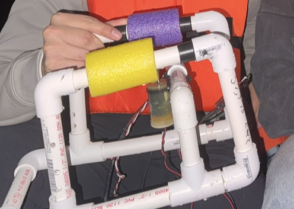
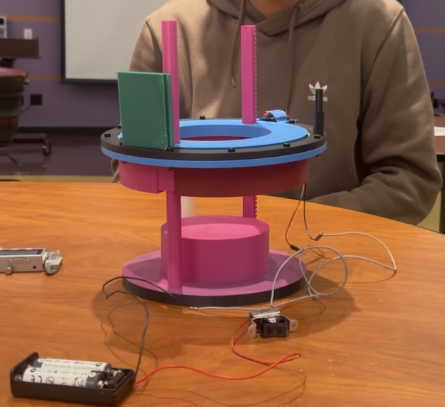
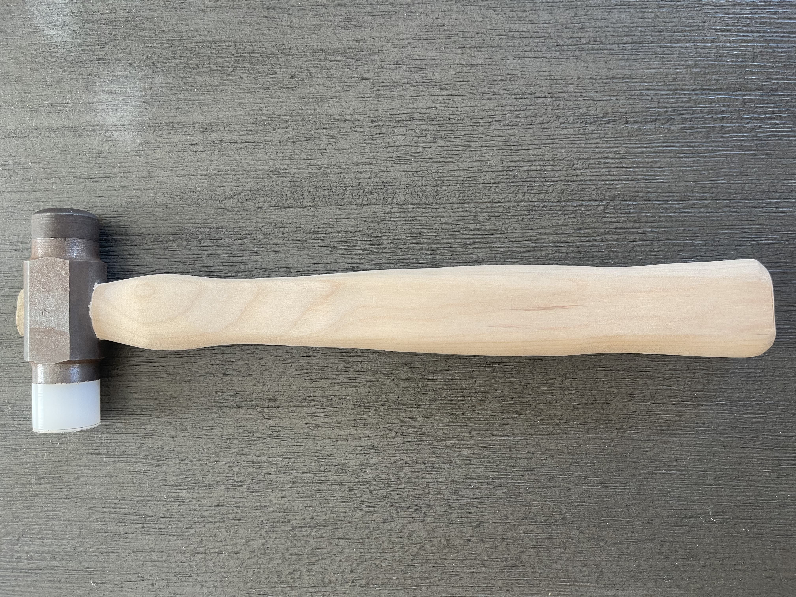

## Experimental Engineering (E80)

```{=html}
<div class="project-grid">
  <a href="project-pages/auv.html" class="project-card">
    
    <div class="project-card-overlay">
      <h3>Autonomous Ocean Profiling Robot for Climate Monitoring</h3>
      <p>C++, MATLAB, Analog Circuit Design, Sensor Calibration, PCB Design</p>
    </div>
  </a>
</div>
```

## Systems Engineering (E79)

```{=html}
<div class="project-grid">
  <a href="project-pages/rov.html" class="project-card">
    
    <div class="project-card-overlay">
      <h3>Submersible Robot with Kp Control</h3>
      <p>LabVIEW, Soldering, PCB Assembly, Oscilloscope, DMM</p>
    </div>
  </a>
</div>
```

## Engineering Design & Manufacturing (E4)

```{=html}
<div class="project-grid">
  <a href="project-pages/laser.html" class="project-card">
    
    <div class="project-card-overlay">
      <h3>Flexible Measuring Laser</h3>
      <p>CAD, Fatigue Analysis, Material Selection, SLS Nylon</p>
    </div>
  </a>
  <a href="project-pages/hammer.html" class="project-card">
    
    <div class="project-card-overlay">
      <h3>Machinist's Hammer</h3>
      <p>GD&T, Lathe, Mill, Bandsaw, Heat Treatment</p>
    </div>
  </a>
</div>
```