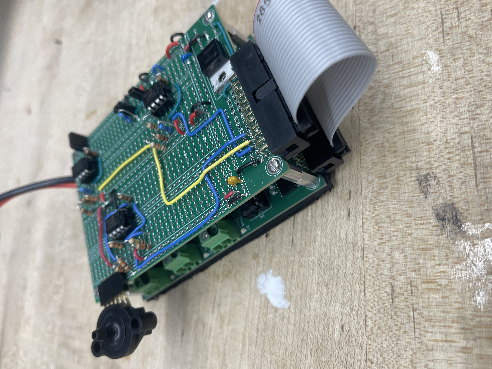
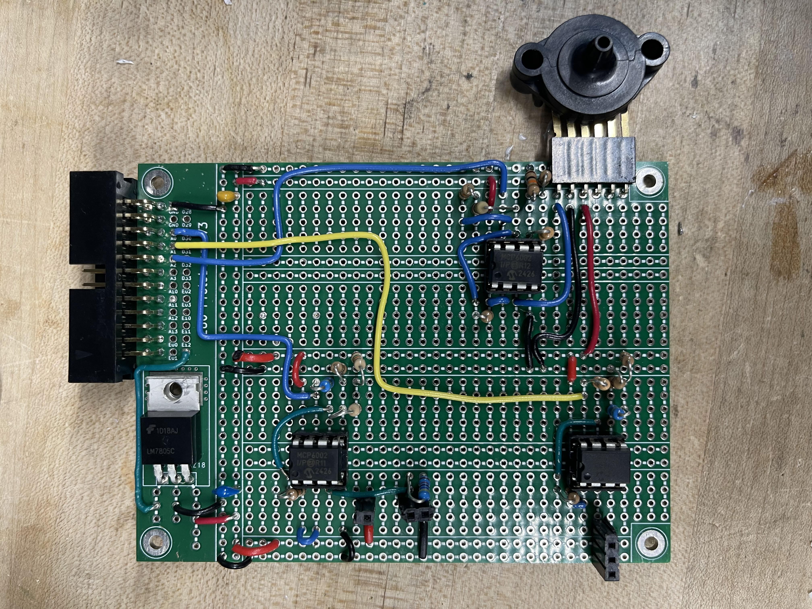
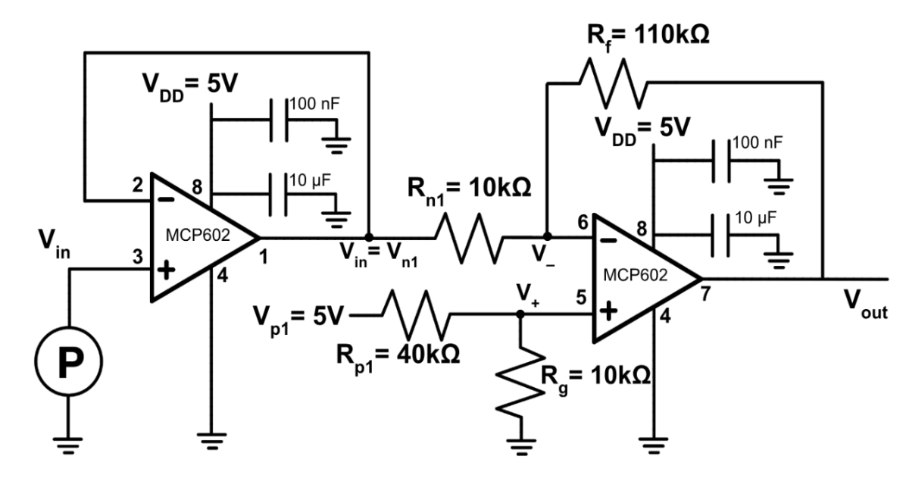
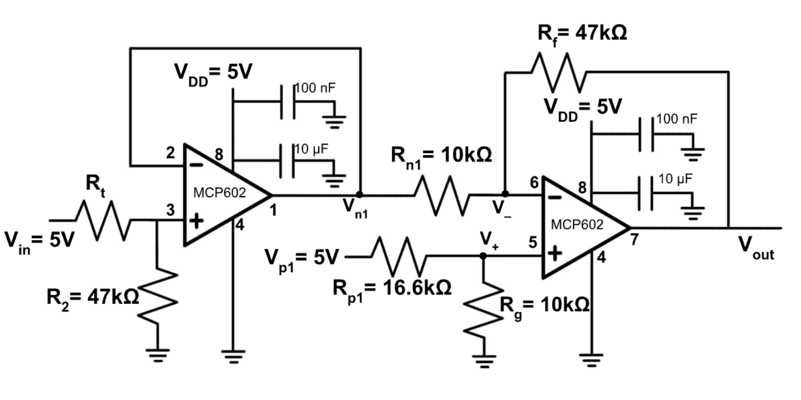
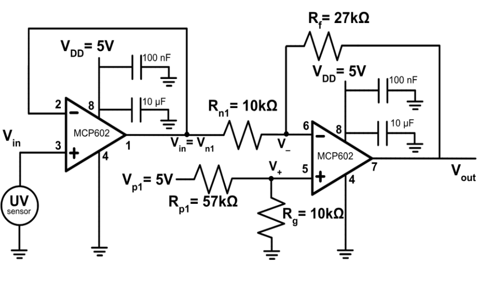
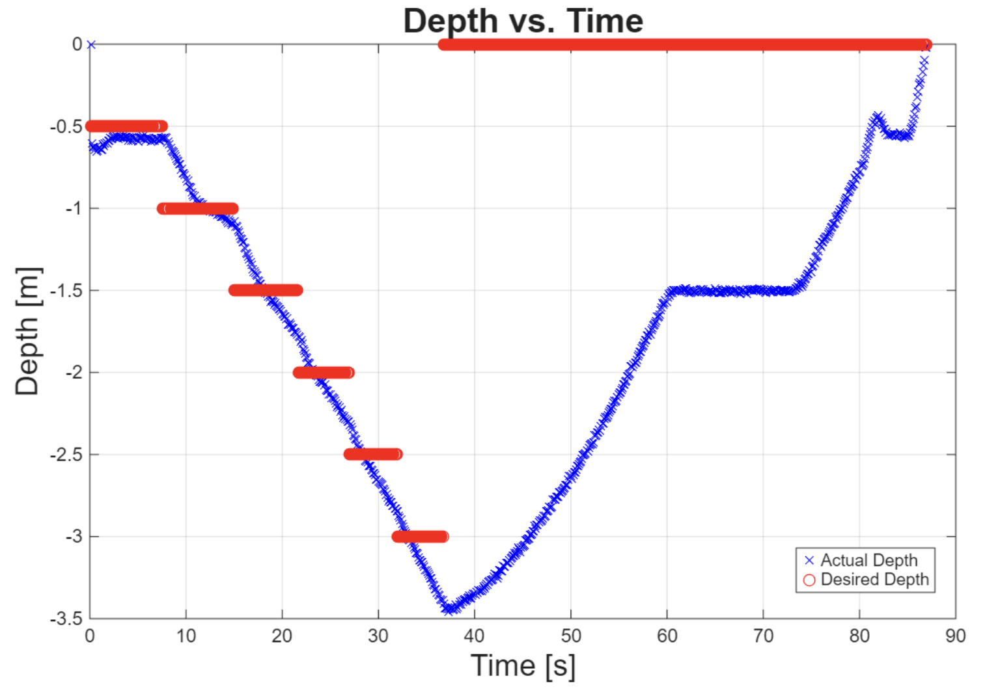
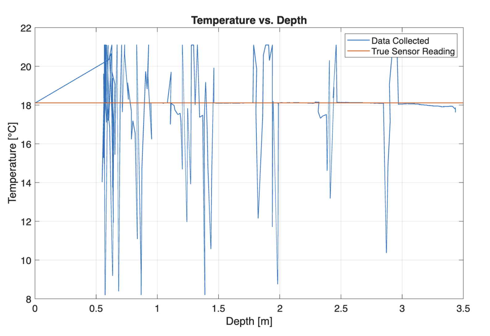
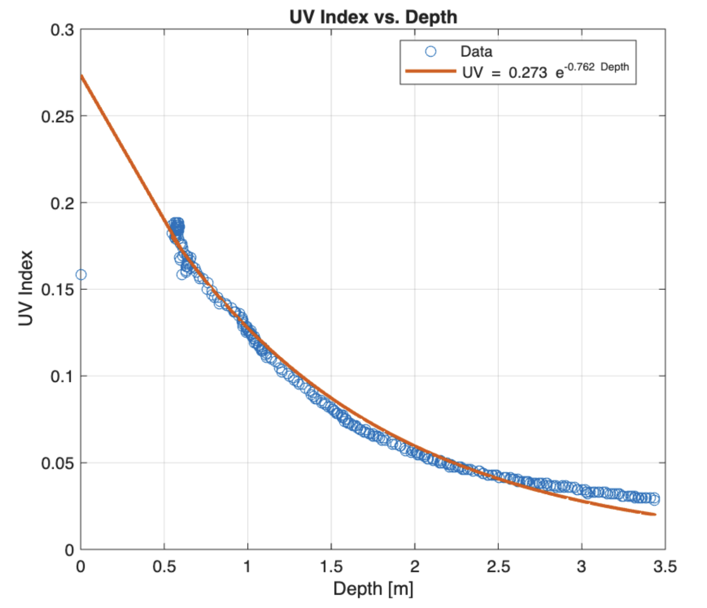

## Experimental Engineering (E80)

### Autonomous Ocean Profiling Robot for Climate Monitoring

:::: {layout="[60,40]"}
::: {}
{width=100%}
:::
::: {}
**Overview:**

Designed and developed a fully functional Autonomous Underwater Robot capable of collecting pressure, temperature, and UV data at depths of up to 3 meters in marine environments at Dana Point. Led the electrical system design, implementing 3 analog circuits with unique interfaces and extensive calibration protocols to ensure accurate underwater measurements. Engineered sensor systems using a unity-gain buffer and inverting gain amplifier to optimize data resolution on the Teensy 4.0. Developed a C++ algorithm for autonomous depth control and MATLAB scripts to visualize collected climate data.

**Skills:**

C++, MATLAB, PCB Design, Sensor Calibration

Show More

- Led electrical system design, implementing 3 analog circuits with voltage-to-voltage, current-to-voltage, and resistance-to-voltage interfaces
- Engineered UV, pressure, and temperature sensor systems using a unity-gain buffer and inverting gain amplifier to optimize data resolution and prevent clipping on the Teensy 4.0
- Developed calibration protocols accounting for noise, sensor non-linearity, and degradation for accurate underwater measurements
- Designed and fabricated a mechanically stable system maintaining neutral buoyancy in saltwater while minimizing axial tilt
- Developed a C++ algorithm for dynamic depth control, enabling autonomous waypoint navigation at various depths
- Created MATLAB scripts to process and visualize temperature and UV intensity as a function of depth for climate monitoring analysis

:::
::::

View More Photos & Files

**PCB Images**

:::: {layout-ncol=2}
::: {}
{width=100%}
:::
::: {}
{width=100%}
:::
::::

**Sensor Interfaces**

:::: {layout-ncol=3}
::: {}
{width=100%}
:::
::: {}
{width=100%}
:::
::: {}
{width=100%}
:::
::::

[View Technical Paper](images/El_Seblani_Ali_E80_Final_Report.pdf) | [View Poster](images/E80_Poster_Team42.pdf)

View Results

:::: {layout-ncol=3}
::: {}
{width=100%}
:::
::: {}
{width=100%}
:::
::: {}
{width=100%}
:::
::::

---

## Systems Engineering (E79)

### Submersible Robot with Kp Control

:::: {layout="[60,40]"}
::: {}
{width=100%}
:::
::: {}
**Overview:**

Constructed an underwater remotely operated vehicle (ROV) to retrieve temperature, pressure, and other signals in lake environments via the MCP9701 thermistor and MPX5700ASX pressure gauge. Assembled a PCB containing the MCP6002 OpAmp to return output voltages modeled and analyzed in LabVIEW.

**Skills:**

LabVIEW, Soldering, PCB Assembly, Oscilloscope, DMM, Breadboarding

Show More

- Constructed an underwater ROV to retrieve temperature, pressure, and other signals in lake environments
- Utilized the MCP9701 thermistor and MPX5700ASX pressure gauge for data collection
- Assembled a PCB containing the MCP6002 OpAmp to return output voltages
- Modeled and analyzed output voltages in LabVIEW

:::
::::

---

## Engineering Design & Manufacturing (E4)

### Flexible Measuring Laser

:::: {layout="[60,40]"}
::: {}
{width=100%}
:::
::: {}
**Overview:**

Designed a precision rack and pinion Z-axis measurement system for SEM sample preparation achieving less than 1mm accuracy, preventing damage within the SEM chamber. Integrated a laser and photosensor with a slew bearing for radial motion to detect the tallest point on samples of variable height. Optimized durability through full material and fatigue analysis, selecting powder nylon for superior wear resistance and dimensional stability.

**Skills:**

CAD, Fatigue Analysis, Material Selection

Show More

- Designed a precision rack and pinion Z-axis measurement system achieving less than 1mm accuracy for SEM sample preparation
- Integrated a laser and photosensor along with a slew bearing for radial motion to detect the tallest point on samples of variable height
- Optimized durability through full material and fatigue analysis, selecting powder nylon (SLS nylon) for superior wear resistance, strength, and dimensional stability under high cycle use
- Delivered a scalable, easily replicable design that improves SEM workflow safety and prevents $1000+ in potential equipment damage from improper sample height

:::
::::

### Machinist's Hammer

:::: {layout="[60,40]"}
::: {}
{width=100%}
:::
::: {}
**Overview:**

Manufactured a precision machinist hammer from clear oak, AISI 1015 steel, AISI 4340 steel, and nylon, adhering to detailed [engineering drawings](images/Hammer-Technical_Drawings.pdf), dimensional tolerances, and safety requirements. Applied turning, facing, milling, tapping, and heat treatment processes to achieve specified mechanical properties.

**Skills:**

GD&T, Lathe, Mill, Bandsaw, Taps, Digital Micrometers, HRC Hardness Tester, Heat Treatment

Show More

- Followed a process router and technical drawings to manufacture each component from raw materials
- Machined all components to tolerances within thousandths of an inch of technical specifications
- Calibrated and operated a lathe and mill to work with steel and nylon
- Applied manufacturing techniques including drilling, tapping, heat treatment, and tempering

:::
::::