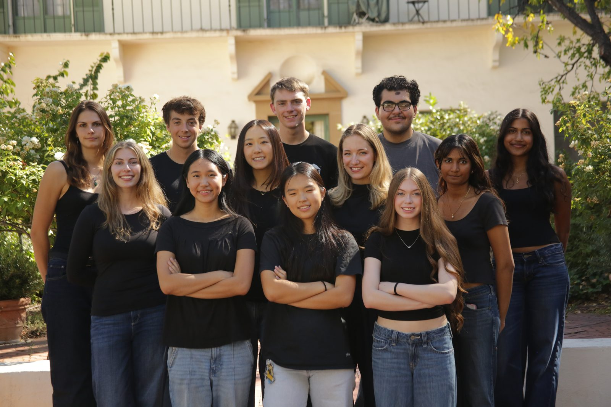
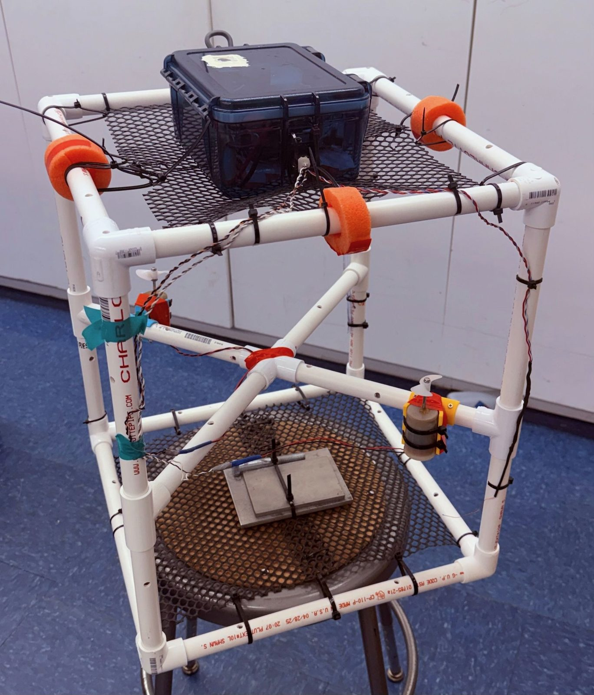
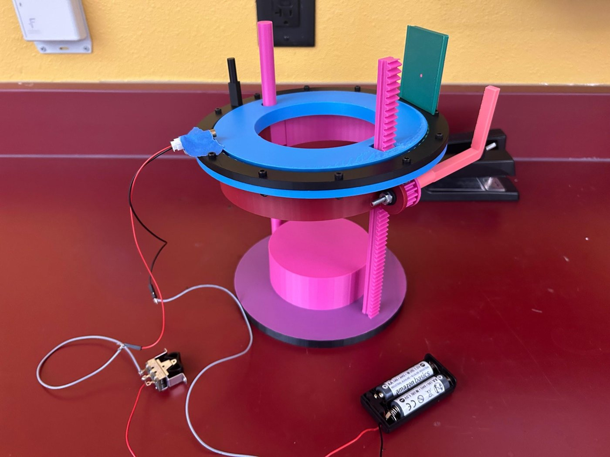
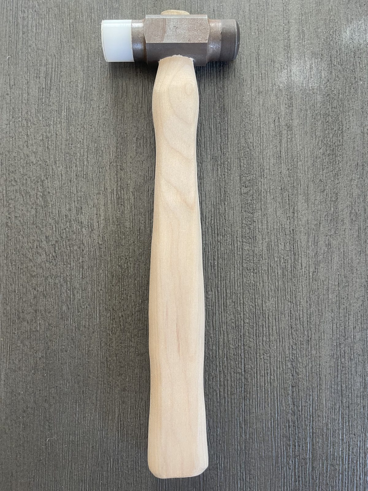

```{=html}
<div class="feature-grid">

  <a class="feature-card" href="racing.html">
    
    <div class="feature-body">
      <p class="feature-kicker">Harvey Mudd Racing · Dec 2025 – Present</p>
      <h3>Harvey Mudd Racing: Powertrain Lead</h3>
      <p class="feature-impact">Leading a 7+ person powertrain team · first competition May 2027</p>
      <div class="chips"><span>Engine systems</span><span>Drivetrain</span><span>Design reviews</span><span>Team leadership</span></div>
    </div>
  </a>

  <a class="feature-card" href="project-pages/auv.html">
    
    <div class="feature-body">
      <p class="feature-kicker">E80 Experimental Engineering · Mar – May 2026</p>
      <h3>Autonomous Ocean Profiling Robot for Climate Monitoring</h3>
      <p class="feature-impact">Autonomous dives to 3 m · UV decayed ~46% per meter</p>
      <div class="chips"><span>C++</span><span>MATLAB</span><span>Analog circuits</span><span>Sensor calibration</span><span>PCB design</span></div>
    </div>
  </a>

  <a class="feature-card" href="project-pages/laser.html">
    
    <div class="feature-body">
      <p class="feature-kicker">E4 Engineering Design &amp; Manufacturing · Oct – Dec 2025</p>
      <h3>SEM Sample Height Measuring Jig</h3>
      <p class="feature-impact">0.39 mm average error · no contact with the sample</p>
      <div class="chips"><span>CAD</span><span>SolidWorks</span><span>Rack and pinion</span><span>Slew bearing</span><span>3D printing (PLA)</span></div>
    </div>
  </a>

  <a class="feature-card" href="project-pages/rov.html">
    
    <div class="feature-body">
      <p class="feature-kicker">E79 Systems Engineering · Oct – Dec 2025</p>
      <h3>Submersible Robot with Kp Control</h3>
      <p class="feature-impact">Underwater ROV measuring temperature and pressure, analyzed in LabVIEW</p>
      <div class="chips"><span>LabVIEW</span><span>Soldering</span><span>PCB assembly</span><span>Oscilloscope</span><span>DMM</span></div>
    </div>
  </a>

  <a class="feature-card" href="project-pages/hammer.html">
    
    <div class="feature-body">
      <p class="feature-kicker">E4 Engineering Design &amp; Manufacturing · Sep – Oct 2025</p>
      <h3>Machinist's Hammer</h3>
      <p class="feature-impact">Machined to within thousandths of an inch</p>
      <div class="chips"><span>GD&amp;T</span><span>Lathe</span><span>Mill</span><span>Bandsaw</span><span>Heat treatment</span></div>
    </div>
  </a>

</div>
```
