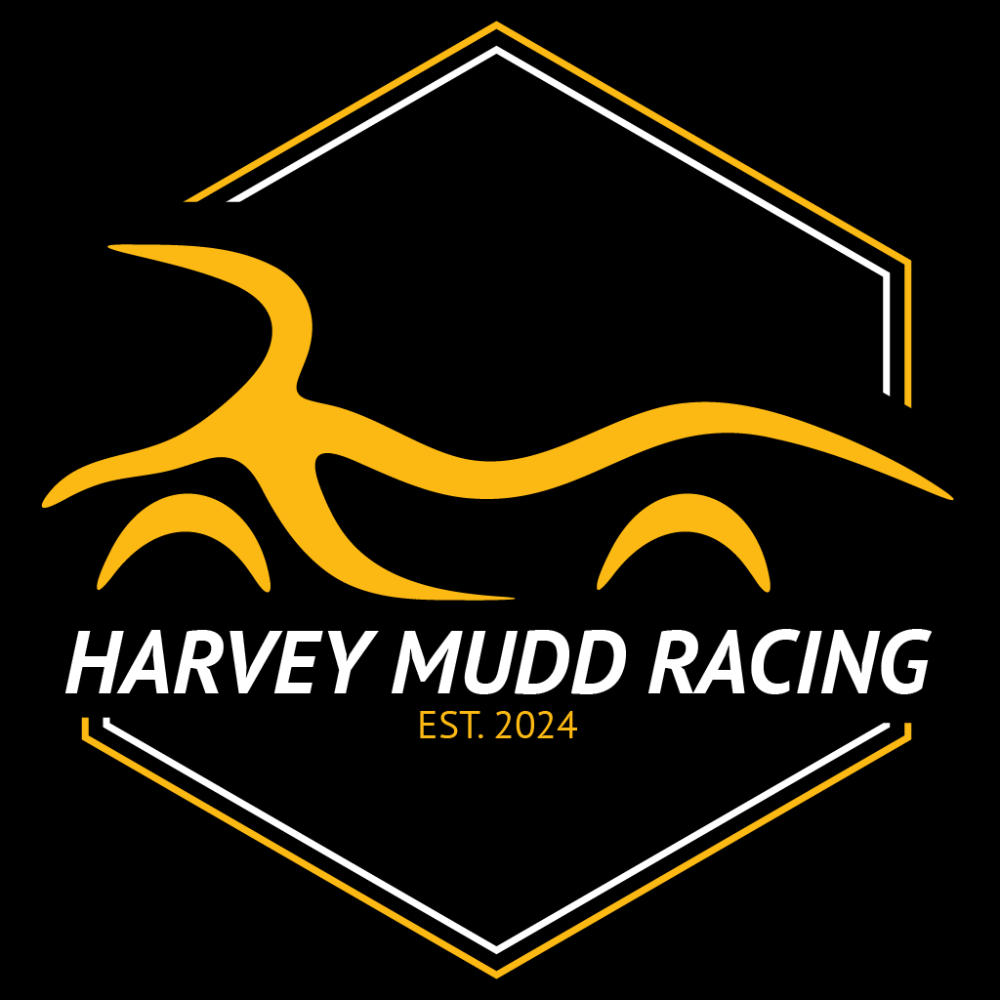
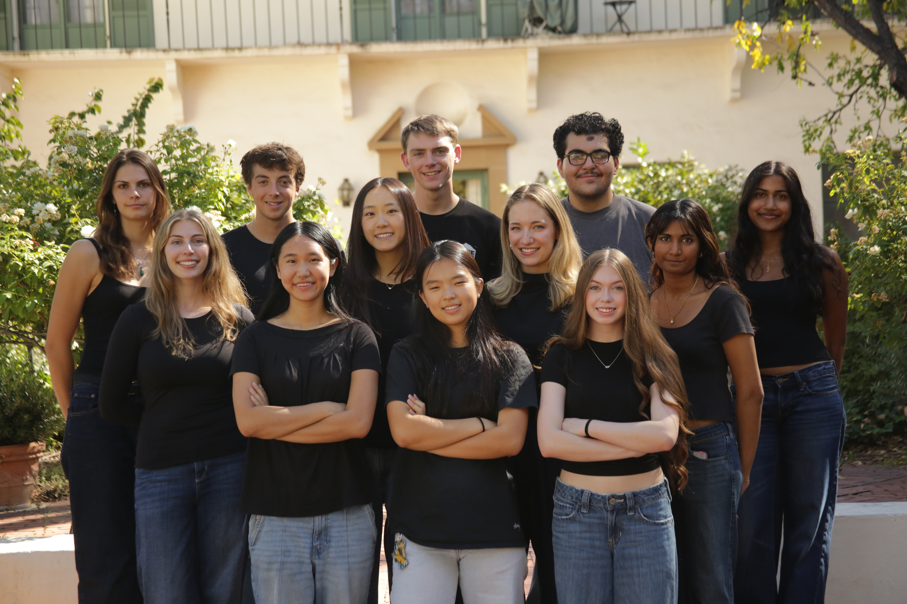

<style>
.project-intro {
  display: grid;
  grid-template-columns: minmax(250px, 0.6fr) 1fr;
  gap: 3rem;
  align-items: center;
  margin-bottom: 2rem;
}

.project-image img {
  width: 100%;
  height: auto;
  display: block;
}

.project-caption {
  font-size: 0.85rem;
  color: #666;
  text-align: center;
  margin-top: 0.5rem;
}

.project-text h2 {
  margin-top: 0;
  padding-top: 0;
}

@media (max-width: 800px) {
  .project-intro {
    grid-template-columns: 1fr;
    gap: 1.5rem;
  }
}
</style>

```{=html}
<div style="border: 1px solid #ddd; border-radius: 6px; padding: 15px 20px; margin-bottom: 30px; background: white;">
  <span style="font-weight: 700; letter-spacing: 2px; font-size: 0.95rem;">HARVEY MUDD RACING</span> — <em style="color: #666;">Powertrain Lead | Formula SAE</em>
</div>

<div class="project-intro">

  <div class="project-image">
   
  </div>

  <div class="project-text">
    <h2>About the Team</h2>

    <p>Formula SAE is an international collegiate engineering competition where student teams design, build, and race a small open-wheel formula-style car. Teams are evaluated across a series of static and dynamic events including design reviews, cost analysis, acceleration, autocross, and endurance — competing against hundreds of universities worldwide.</p>

    <p>Harvey Mudd Racing is a first-year team currently in the full design and build phase of our inaugural car. We are a group of engineers working from the ground up, and we are excited to compete this coming May.</p>
  </div>

</div>


<p style="font-size: 1rem; color: #000; text-align: center; margin-bottom: 30px; font-weight: 600;">The Harvey Mudd Racing Team</p>
```

## My Role

As Powertrain Lead, I am leading a 7+ member team through the design, analysis, and integration of engine systems including cooling and fuel, transmission and shifting mechanisms, and the drivetrain. This includes conducting weekly design reviews to align subsystem timelines and technical decisions across the team.

```{=html}
<div style="background: #fff; border: 1px solid #dde3ea; border-radius: 8px; padding: 1rem 1.25rem; margin: 1.5rem 0; line-height: 1.7;">
  <strong>Project details</strong><br>
  <strong>Role:</strong> Powertrain Lead &nbsp;·&nbsp; <strong>Since:</strong> December 2025<br>
  <strong>Team:</strong> 7+ members &nbsp;·&nbsp; <strong>Status:</strong> Design and build, competing May 2027<br>
  <strong>Systems:</strong> Engine (cooling, fuel), transmission and shifting, drivetrain
</div>
```

## Timeline

The car is in the design and build phase. Here is our high-level plan to competition:

```{=html}
<style>
.tl { display: flex; justify-content: space-between; position: relative; margin: 2rem 0 2.5rem; }
.tl::before { content: ""; position: absolute; top: 6px; left: 10%; right: 10%; height: 4px; background: #2c3e50; }
.tl-item { position: relative; flex: 1; text-align: center; padding: 0 0.5rem; }
.tl-item::before { content: ""; display: block; width: 16px; height: 16px; border-radius: 50%; background: #2c3e50; margin: 0 auto 0.75rem; position: relative; z-index: 1; }
.tl-item.next::before { background: #1f4e8c; box-shadow: 0 0 0 5px rgba(31, 78, 140, 0.25); }
.tl-item.done::before { background: #2e7d32; }
.tl-date { font-weight: 700; font-size: 0.95rem; }
.tl-text { font-size: 0.88rem; line-height: 1.4; color: #333; margin-top: 0.2rem; }
.tl-tag { display: inline-block; font-size: 0.7rem; background: #e8f0fa; color: #1f4e8c; border-radius: 999px; padding: 0.05rem 0.55rem; margin: 0.35rem 0.15rem 0; font-weight: 600; }

@media (max-width: 700px) {
  .tl { flex-direction: column; }
  .tl::before { left: 6px; right: auto; top: 8px; bottom: 8px; width: 4px; height: auto; }
  .tl-item { text-align: left; padding: 0 0 1.5rem 2rem; }
  .tl-item::before { position: absolute; left: 0; top: 2px; margin: 0; }
}
</style>

<div class="tl">
  <div class="tl-item next">
    <div class="tl-date">Nov 26</div>
    <div class="tl-text">Finalize design of drivetrain</div>
    <span class="tl-tag">Next</span>
  </div>
  <div class="tl-item">
    <div class="tl-date">Dec 12</div>
    <div class="tl-text">Engine running with all needed technical components</div>
  </div>
  <div class="tl-item">
    <div class="tl-date">Mar 1</div>
    <div class="tl-text">Finished build of all car parts</div>
  </div>
  <div class="tl-item">
    <div class="tl-date">Apr 1</div>
    <div class="tl-text">Testing and fine tuning</div>
  </div>
  <div class="tl-item">
    <div class="tl-date">May 1</div>
    <div class="tl-text">Finalized car, finished assembly</div>
  </div>
</div>
```

## Systems I Lead

```{=html}
<div style="display: grid; grid-template-columns: repeat(auto-fit, minmax(260px, 1fr)); gap: 1.25rem; margin: 1rem 0 1.5rem;">
  <a href="project-pages/engine.html" style="display: block; background: #fff; border: 1px solid #dde3ea; border-radius: 10px; padding: 1.1rem 1.25rem; text-decoration: none; color: inherit;">
    <h3 style="margin: 0 0 0.4rem;">Engine Systems</h3>
    <p style="margin: 0 0 0.5rem; font-size: 0.92rem; line-height: 1.45;">Cooling and fuel systems for the car's Honda CBR600F4i engine.</p>
    <p style="margin: 0; font-weight: 700; color: #1f4e8c; font-size: 0.9rem;">Target: engine running by Dec 12</p>
  </a>
  <a href="project-pages/drivetrain.html" style="display: block; background: #fff; border: 1px solid #dde3ea; border-radius: 10px; padding: 1.1rem 1.25rem; text-decoration: none; color: inherit;">
    <h3 style="margin: 0 0 0.4rem;">Drivetrain</h3>
    <p style="margin: 0 0 0.5rem; font-size: 0.92rem; line-height: 1.45;">Transmission and shifting, final drive, differential, chain tensioner, and half shafts.</p>
    <p style="margin: 0; font-weight: 700; color: #1f4e8c; font-size: 0.9rem;">Target: design final by Nov 26</p>
  </a>
</div>
```

I'll update this page as the car comes together.

---

```{=html}
<a href="https://harveymuddracing.com/" target="_blank" style="font-weight: 600;">Visit Harvey Mudd Racing →</a>
```