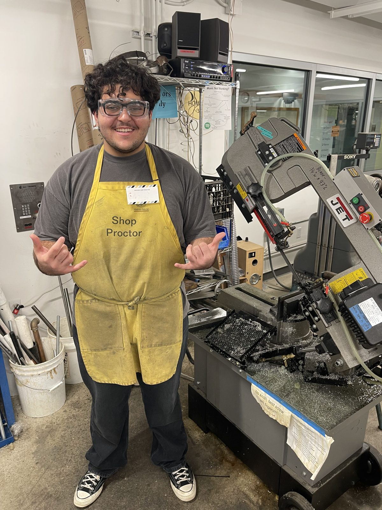

```{=html}
<div class="feature-grid">

  <a class="feature-card" href="project-pages/GeneralMotors.html">
    
    <div class="feature-body">
      <p class="feature-kicker">General Motors · May – Aug 2026 · Burton, MI</p>
      <h3>Manufacturing Engineering Intern</h3>
      <p class="feature-impact">63% fewer material touches · ~$1M/yr projected savings</p>
      <div class="chips"><span>DFSS Green Belt</span><span>Process modeling</span><span>Workstation design</span><span>ASRS integration</span></div>
    </div>
  </a>

  <a class="feature-card" href="project-pages/machineshop.html">
    
    <div class="feature-body">
      <p class="feature-kicker">Harvey Mudd College · Dec 2025 – Present</p>
      <h3>Machine Shop Proctor</h3>
      <p class="feature-impact">Promoting safe machine use for 80+ students each semester</p>
      <div class="chips"><span>Machining</span><span>Shop safety</span><span>Tooling</span><span>Mentorship</span></div>
    </div>
  </a>

  <a class="feature-card" href="project-pages/e79proctor.html">
    
    <div class="feature-body">
      <p class="feature-kicker">Harvey Mudd College · May 2026 – Present</p>
      <h3>Systems Engineering Practicum Proctor</h3>
      <p class="feature-impact">Guiding student teams through hands-on underwater-robotics practicums</p>
      <div class="chips"><span>Underwater robotics</span><span>Systems engineering</span><span>Lab safety</span></div>
    </div>
  </a>

  <a class="feature-card" href="project-pages/dasion.html">
    
    <div class="feature-body">
      <p class="feature-kicker">Dasion · May – Aug 2025 · Claremont, CA</p>
      <h3>Software Engineering Intern</h3>
      <p class="feature-impact">89% diagnostic accuracy on medical imaging data · est. 35% less data-prep time</p>
      <div class="chips"><span>Python</span><span>Machine learning</span><span>Data preprocessing</span><span>Spotify API</span></div>
    </div>
  </a>

</div>
```
